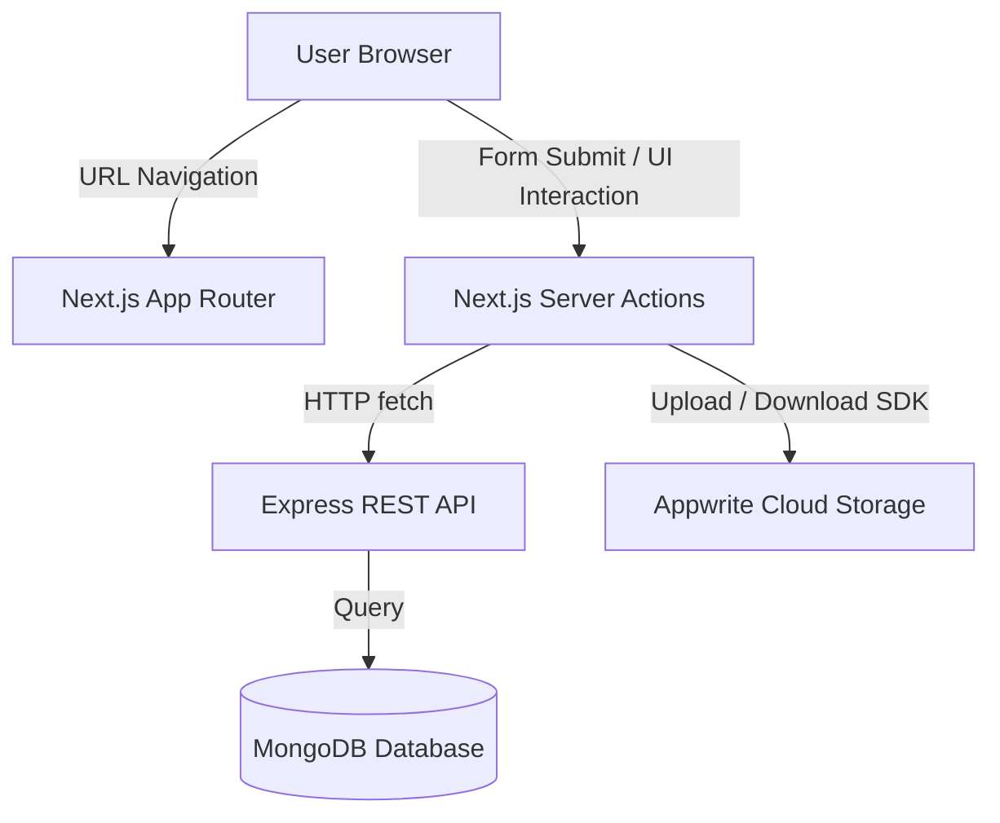

# 🏗️ Cloudy Architecture & Connections Guide

This guide explains the routing systems in Next.js and Express, how the frontend and backend communicate, and how **MongoDB** and **Appwrite** work together to manage users and files.

---

## 1. Routing Systems: Next.js vs. Express.js

Cloudy uses a dual-routing system. The frontend handles page routing and server actions, while the backend serves REST API endpoints.



### A. Next.js Routing (App Router)
Next.js uses a **file-system based router** under the `app/` directory. Folders define the URL path segments, and `page.tsx` defines the UI.

* **Route Groups `(auth)`**: Folders wrapped in parentheses (e.g., `app/(auth)`) are used to group routes logically without affecting the URL.
  * `app/(auth)/sign-up/page.tsx` renders at `/sign-up`.
* **Server Actions**: Instead of creating traditional API endpoints for frontend actions, Next.js uses server-side functions labeled `"use server"`. They act as secure RPCs (Remote Procedure Calls).

```typescript
// Example: Next.js Server Action in lib/actions/user.actions.ts
"use server"

export const signInUser = async ({ email, password }) => {
    const response = await fetch("http://localhost:5000/api/auth/signin", {
        method: "POST",
        headers: { "Content-Type": "application/json" },
        body: JSON.stringify({ email, password }),
    });
    return response.json();
};
```

### B. Express.js Routing (REST API)
Express handles business logic and DB transactions via standard HTTP methods (`GET`, `POST`, `PATCH`, `DELETE`).

```javascript
// Example: Express Route in backend/server.js
app.post("/api/auth/signin", async (req, res) => {
  const { email, password } = req.body;
  
  // 1. Fetch user from MongoDB
  const user = await User.findOne({ email });
  if (!user) return res.status(404).json({ error: "User not found" });

  // 2. Validate password using bcrypt
  const isMatch = await bcrypt.compare(password, user.password);
  if (!isMatch) return res.status(400).json({ error: "Invalid password" });

  // 3. Initiate OTP verification
  const otp = randomize("0", 6);
  user.otpCode = otp;
  await user.save();
  
  res.json({ accountId: user._id.toString() });
});
```

---

## 2. Frontend-Backend Connectivity & Session Security

Next.js communicates with the Express backend using Server Actions, protecting credentials from the client side.

```
[Browser]                     [Next.js Server Action]              [Express Backend]
   │                                   │                                   │
   │ 1. Submit email/password          │                                   │
   ├──────────────────────────────────>│                                   │
   │                                   │ 2. POST /api/auth/signin          │
   │                                   ├──────────────────────────────────>│
   │                                   │                                   │ (Validate password)
   │                                   │                                   │ (Generate & Email OTP)
   │                                   │ 3. Return accountId               │
   │                                   │<──────────────────────────────────┤
   │ 4. Open OTP Modal                 │                                   │
   │<──────────────────────────────────┤                                   │
   │                                   │                                   │
   │ 5. Submit OTP code                │                                   │
   ├──────────────────────────────────>│                                   │
   │                                   │ 6. POST /api/auth/verify          │
   │                                   ├──────────────────────────────────>│
   │                                   │                                   │ (Validate OTP)
   │                                   │                                   │ (Issue signed JWT)
   │                                   │ 7. Return JWT Token               │
   │                                   │<──────────────────────────────────┤
   │ 8. Save JWT to HttpOnly Cookie    │                                   │
   │    "appwrite-session"             │                                   │
   │<──────────────────────────────────┤                                   │
```

> [!IMPORTANT]
> **Why HttpOnly Cookies?**
> When the Express backend returns a JWT, Next.js stores it in a cookie marked `httpOnly: true`. This prevents client-side JavaScript from accessing the token, protecting it from Cross-Site Scripting (XSS) attacks.

---

## 3. Connecting MongoDB and Appwrite

The backend runs on **MongoDB** to handle user profiles and credentials, while **Appwrite** acts as the object storage bucket (storing raw files) and database tracker for files.

| Database / Service | Role in the Ecosystem | Technology Stack |
| :--- | :--- | :--- |
| **MongoDB** | Primary Transactional DB | Express.js, Mongoose, MongoDB Atlas |
| **Appwrite Storage** | Binary Blob Storage (like S3) | node-appwrite SDK |
| **Appwrite Database** | File Metadata Collection | node-appwrite SDK |

### Connection Credentials
1. **MongoDB Connection**: Handled in `backend/server.js` using Mongoose:
   ```javascript
   mongoose.connect(process.env.MONGODB_URI);
   ```
2. **Appwrite Client Connection**: Instantiated in `lib/appwrite/index.ts` using the Secret Keys from environment variables:
   ```typescript
   import { Client, Account, Databases, Storage } from "node-appwrite";

   export const createAdminClient = async () => {
     const client = new Client()
       .setEndpoint(process.env.NEXT_PUBLIC_APPWRITE_ENDPOINT!)
       .setProject(process.env.NEXT_PUBLIC_APPWRITE_PROJECT!)
       .setKey(process.env.NEXT_APPWRITE_SECRET!); // Secret API key

     return {
       get databases() { return new Databases(client); },
       get storage() { return new Storage(client); },
     };
   };
   ```

---

## 4. File Upload & Linking Data Models

When a user uploads a file, it is saved into Appwrite and mapped directly to a MongoDB user ID.

### Step-by-Step Data Flow: Uploading a File
1. **Read File Buffer**: On the frontend, `react-dropzone` captures the file. The Next.js Server Action converts it into a Node `Buffer` so it can be streamed to the Appwrite SDK:
   ```typescript
   const buffer = await file.arrayBuffer();
   const inputFile = InputFile.fromBuffer(Buffer.from(buffer), file.name);
   ```
2. **Save to Appwrite Storage**: The file binary is uploaded to the Appwrite Storage bucket, returning a unique `bucketFileId` and URL:
   ```typescript
   const bucketFile = await storage.createFile(
       appwriteConfig.bucketId,
       ID.unique(),
       inputFile
   );
   ```
3. **Link to MongoDB User**: In the file metadata document, we save the owner field mapping to the MongoDB User ID (`ownerId`), creating a logical link:
   ```typescript
   const fileDoc = {
       name: bucketFile.name,
       type: getFileType(bucketFile.name).type,
       url: constructFileUrl(bucketFile.$id),
       size: bucketFile.sizeOriginal,
       owner: ownerId, // Holds the MongoDB User ID (e.g., "6a6c5574f2044411c04b...")
       bucketFileId: bucketFile.$id, // Holds the Appwrite Storage ID
       users: [], // Shared users list
   };

   // Write metadata to Appwrite Databases
   const newFile = await databases.createDocument(
       appwriteConfig.databaseId,
       appwriteConfig.filesCollectionId,
       ID.unique(),
       fileDoc
   );
   ```

---

## 5. Fetching Files Uploaded by the User

To fetch files, we query Appwrite Databases and join/populate the owner details from MongoDB.

### Step-by-Step Data Flow: Retrieving Files
1. **Get Authenticated User**: Next.js retrieves the current user's profile details from the Express `/api/auth/me` endpoint using the JWT cookie.
2. **Query Appwrite Metadata**: We query Appwrite Databases to find files where the user is the **owner** (MongoDB ID match) OR the user's email is in the **shared users** list:
   ```typescript
   const queries = [
       Query.or([
           Query.equal("owner", [currentUser.$id]), // MongoDB User ID match
           Query.contains("users", [currentUser.email]) // Email match for shared files
       ]),
   ];

   const files = await databases.listDocuments(
       appwriteConfig.databaseId,
       appwriteConfig.filesCollectionId,
       queries
   );
   ```
3. **Populate Owner details from MongoDB**: Since Appwrite does not know anything about MongoDB's user collection, we loop through the retrieved files and make a request to the Express API (`/api/auth/users/:id`) to fetch the name and avatar for each file owner:
   ```typescript
   const populatedDocuments = await Promise.all(
     files.documents.map(async (file) => {
       const owner = await fetch(`http://localhost:5000/api/auth/users/${file.owner}`)
         .then(res => res.json());
       return { ...file, owner };
     })
   );
   ```
