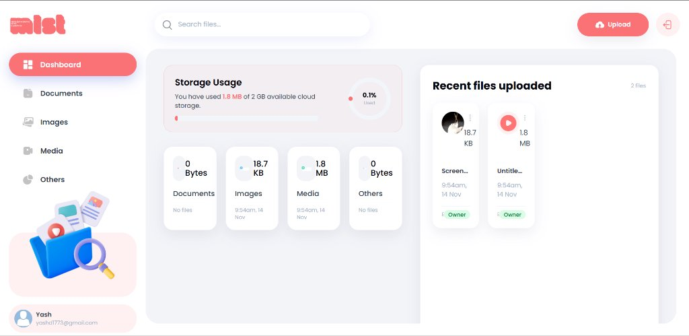

# Mist Cloud

A modern, responsive personal cloud storage application inspired by Google Drive and Dropbox. Upload, organize, preview, download, and share your files securely in the cloud.



---

## What is this project?

Mist Cloud is a full-stack cloud storage web application. It features a fast **React** single-page application on the frontend and an **Express (Node.js)** REST API on the backend, with **AWS S3** for file storage and **MongoDB** for database records.

A key highlight of the project is its **zero-setup resilience**: if MongoDB or AWS S3 credentials are not configured, the app automatically falls back to an in-memory data store and local disk storage (`/uploads`). This allows anyone to clone and run it immediately for local testing without needing third-party cloud accounts.

---

## Key Features

- **File Uploads**: Drag-and-drop multi-file uploader with real-time upload progress meters (supports files up to 50 MB).
- **Direct Browser Previews**: Click any file to view images, PDFs, videos, audio, or text files directly in the browser via secure AWS S3 presigned URLs.
- **Storage Analytics**: Dashboard gauge showing total space used and categorized breakdowns across Documents, Images, Media, and Others (2 GB default quota).
- **File Operations**:
  - Download files directly to your device.
  - Rename files while preserving their extension.
  - View file details (size, format, owner, upload date).
  - Delete files with permanent storage cleanup.
- **Email-Based Sharing**: Share files with specific users by email address and manage access lists in an overlay dialog.
- **Global Search & Sorting**: Real-time debounced search across file names and types, with sorting by date, name, and size.
- **Passwordless OTP Login**: Clean authentication flow using 6-digit one-time verification codes sent to email (with terminal console logging fallback for development).

---

## Tech Stack

- **Frontend**: React 19, TypeScript, Vite, Tailwind CSS 4, React Router 7, Sonner (toasts), Recharts (storage charts)
- **Backend**: Node.js, Express 5, Multer (multipart upload handling)
- **Database**: MongoDB & Mongoose (with automatic in-memory fallback)
- **Storage**: AWS S3 via AWS SDK v3 (with local disk storage fallback)
- **Authentication**: JSON Web Tokens (JWT) & passwordless email OTP

---

## Project Structure

```
mistcloud/
├── backend/            # Express REST API
│   ├── config/         # MongoDB, AWS S3, and in-memory store setup
│   ├── controllers/    # Route handlers (auth, files, search)
│   ├── middleware/     # JWT authentication and Multer upload handling
│   ├── models/         # Mongoose schemas (User, File)
│   ├── routes/         # Express API routes (/api/auth, /api/files, /api/search)
│   └── services/       # AWS S3 presigned URL generator & email service
│
├── frontend/           # React 19 single-page application
│   ├── src/
│   │   ├── api/        # Axios API clients
│   │   ├── components/ # Dashboard UI components (Sidebar, Card, Header, ActionDropdown)
│   │   ├── context/    # User authentication state (AuthContext)
│   │   ├── pages/      # Dashboard, Category views, Sign-in, Sign-up
│   │   └── utils/      # Formatting helpers (file sizes, dates, file icons)
│   └── vite.config.ts
│
└── server.js           # Unified Express server hosting both API and built React SPA
```

---

## Quick Start Guide

### 1. Clone the repository

```bash
git clone https://github.com/your-username/mistcloud.git
cd mistcloud
```

### 2. Install dependencies

```bash
# Install backend & root dependencies
npm install

# Install frontend dependencies
cd frontend
npm install
cd ..
```

### 3. Environment Variables

Create a `.env` file in the `mistcloud/` folder:

```bash
cp .env.example .env
```

Here are the primary variables:

```env
# Database (Optional: falls back to in-memory store if omitted)
MONGODB_URI=mongodb://127.0.0.1:27017/mistcloud

# AWS S3 Storage (Optional: falls back to local /uploads if omitted)
AWS_ACCESS_KEY_ID=your_access_key
AWS_SECRET_ACCESS_KEY=your_secret_key
AWS_REGION=us-east-1
AWS_S3_BUCKET_NAME=your_bucket_name

# Authentication
JWT_SECRET=your_jwt_secret_key

# Email for OTP (Optional: logs OTP to terminal console if omitted)
SMTP_HOST=smtp.gmail.com
SMTP_PORT=587
SMTP_USER=your-email@gmail.com
SMTP_PASS=your-app-password

# Server
PORT=3000
NODE_ENV=development
```

### 4. Run the application

#### Development Mode (Builds frontend and starts unified server)

```bash
npm run dev
```

#### Production Mode

```bash
npm run build
npm start
```

Open **http://localhost:3000** in your browser to start using Mist Cloud.
