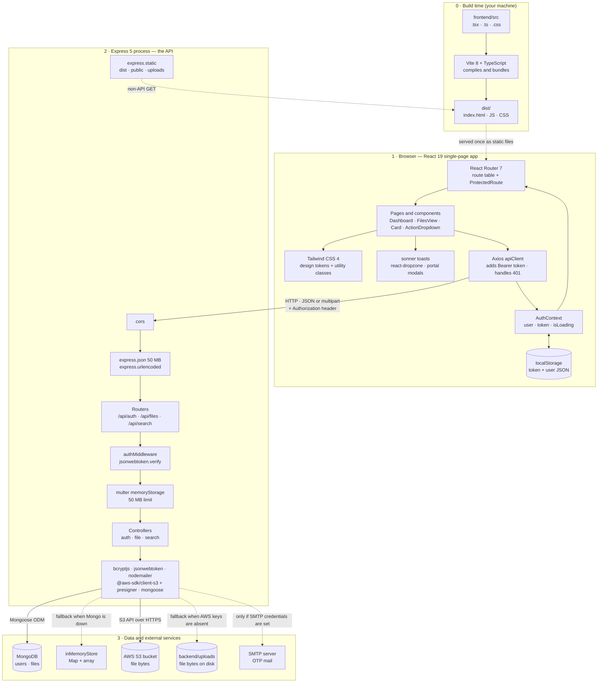

# 00 — Technology Architecture (every technology in one picture)

This is the "connect everything" view. It answers three questions in one place:

1. Which technologies exist in the project, and which layer does each belong to?
2. Which technology talks to which, and over what protocol?
3. What actually happens, in simple terms, when a user clicks something?

For file-by-file detail see [01-system-architecture.md](01-system-architecture.md); for step-by-step
sequences see [03-workflows.md](03-workflows.md); for the data shapes see
[04-data-model.md](04-data-model.md).

## 1. The full stack, layer by layer

**How to read it:** time flows top to bottom. `0` is build time, `1` is the browser, `2` is the
Node process, `3` is storage and external services. Arrows are calls. Solid arrows are the normal
path; dashed arrows are the automatic fallback when the real service is not configured.

**In plain words.** Read the diagram as four floors of one building.

- **Floor 0 — the print shop.** Before anything runs, Vite reads the TypeScript and React source,
  bundles it and writes plain `.html`, `.js` and `.css` into `dist/`. Nobody at runtime needs
  TypeScript or Vite; they only need those finished files. `npm run dev` does this step every time,
  which is why it feels slow.
- **Floor 1 — the shop counter.** The browser runs React. React Router decides which page to show
  from the URL. Tailwind supplies the styling, `sonner` shows toasts, `react-dropzone` handles the
  drag-and-drop upload area. `AuthContext` is the app's memory of "who is logged in", and it keeps a
  copy in `localStorage` so a refresh does not log you out. Axios is the messenger: every call it
  makes gets the token attached, and every `401` it sees clears the login.
- **Floor 2 — the back office.** Express receives HTTP. `cors` decides which sites may call,
  `express.json` unpacks JSON bodies, `multer` catches file uploads. The router sends the request to
  the right controller, but first `authMiddleware` checks the JWT and loads the user. Controllers do
  the actual work and call one of the libraries: bcrypt for passwords, JWT for tokens, nodemailer for
  mail, the AWS SDK for storage, Mongoose for the database.
- **Floor 3 — the storerooms.** MongoDB keeps rows *about* files; S3 or `backend/uploads` keeps the
  bytes; SMTP only sends mail. The dashed arrows are the important design decision: every real
  service has a local stand-in, and the app switches automatically when configuration is missing.

**The single most useful sentence:** React asks, Express decides, Mongo remembers *what*, S3 or the
disk remembers *the bytes*, and S3 hands the bytes to the browser directly through a temporary link.

## 2. One upload and one download, through every technology

This diagram follows two real user actions through the same stack, so you can see where each
technology enters and leaves. Numbers are the order of events.

```mermaid
flowchart TB
    subgraph UP["Upload — from a dropped file to a stored file"]
        U1["1 · FileUploader<br/>react-dropzone checks ≤ 50 MB"] --> U2["2 · Axios<br/>POST /api/files/upload · FormData + Bearer"]
        U2 --> U3["3 · Express edge<br/>cors · body parser · authMiddleware"]
        U3 --> U4["4 · multer<br/>whole file buffered in RAM"]
        U4 --> U5["5 · file.controller<br/>extension → document/image/video/audio/other"]
        U5 --> U6["6 · s3.service<br/>key = timestamp + random + extension"]
        U6 --> U7["7 · AWS SDK or fs<br/>bytes → S3 bucket or backend/uploads"]
        U7 --> U8["8 · Mongoose<br/>metadata row: owner · size · type · key"]
        U8 --> U9["9 · response + sonner toast<br/>refreshTrigger++ → list re-fetch"]
    end

    subgraph DOWN["Open or download — from a click to bytes in a tab"]
        D1["1 · Card / ActionDropdown<br/>/api/files/:id/download?token=JWT"] --> D2["2 · authMiddleware<br/>reads token from the query string"]
        D2 --> D3["3 · file.controller<br/>loads the metadata row"]
        D3 --> D4["4a · S3 mode<br/>presign a 1-hour GET URL"]
        D4 --> D5["5a · browser<br/>downloads directly from S3"]
        D3 --> D6["4b · local-disk mode<br/>res.sendFile or res.download streams bytes"]
    end
```

**In plain words.** Upload is a two-store operation, and the order matters.

1. The browser holds the file and checks its size. Nothing has touched the server yet.
2. Axios wraps it in `FormData` and sends it with the login token.
3. Express parses the request and the guard confirms who the user is.
4. `multer` reads the whole upload into memory. The server now holds a full copy of the file in RAM.
5. The controller looks only at the filename ending to decide which tab the file belongs to.
6. It builds a safe storage key — never the user's filename, so two people uploading `report.pdf`
   do not collide.
7. The bytes are written to S3 (or to the disk folder). This is the point of no return: the blob
   now exists.
8. Only then is the database row written: who owns it, how big it is, what category, and which key
   points at the bytes.
9. The browser gets the row back, shows a toast, and the list quietly re-fetches so the new file
   appears.

Download is deliberately shorter.

1. The card opens a URL in a new tab. Because a new tab cannot send custom headers, the token rides
   in the query string.
2. The guard accepts it there and loads the user.
3. The controller loads the row — it needs the key, not the bytes.
4. In S3 mode it asks AWS to sign a URL that is already authorised for one hour, then answers with a
   redirect.
5. The browser follows the redirect and pulls the bytes straight from S3, so the Node process is not
   in the data path at all. In local-disk mode there is no S3 to redirect to, so Express reads the
   file and streams it back itself.

That asymmetry is the whole reason the app feels fast with S3 and slower with local disk.

## 3. What every technology is doing here

| Technology | What it is, plainly | Its job in Mist Cloud | If it were missing |
| --- | --- | --- | --- |
| **React 19** | A UI library: screens built from reusable components | Renders every page and keeps the screen in sync with data | No interface at all |
| **React Router 7** | An in-browser URL router | Maps URL → page, guards private pages, keeps deep links working | One page only; refresh would break |
| **Tailwind CSS 4** | Utility CSS classes | All styling and design tokens (`bg-brand`, `primary-btn`, …) | Unstyled HTML |
| **sonner** | Toast notification library | Success/error popups after uploads and edits | Silent feedback |
| **react-dropzone** | Drag-and-drop wrapper | The upload target and file picker | Plain file input |
| **Axios** | HTTP client | JSON + multipart calls, token header, global 401 handling | Hand-written `fetch` everywhere |
| **AuthContext** | React context | Holds `user`, `token`, `isLoading` for the whole app | Every page re-reads storage |
| **localStorage** | Browser key–value store | Remembers token + user across refreshes | Logged out on every refresh |
| **TypeScript** | JavaScript with types | Catches shape mistakes while building | Runtime surprises |
| **Vite 8** | Dev server + bundler | Compiles `.tsx`, hot reload in dev, writes `dist/` | Manual build setup |
| **Express 5** | Node HTTP framework | Routing, middleware, static files, the API itself | Raw `node:http` |
| **cors** | Middleware | Allows the dev frontend origin to call the API | Browser blocks requests |
| **express.json / urlencoded** | Body parsers | Turn request bytes into `req.body` | `req.body` is empty |
| **multer** | Multipart parser | Receives uploads into RAM, enforces 50 MB | Uploads impossible |
| **jsonwebtoken** | JWT sign/verify | Issues and checks the 30-day bearer token | No stateless session |
| **bcryptjs** | Password hashing | Scrambles and compares passwords | Plaintext passwords |
| **nodemailer** | SMTP client | Sends the OTP email | Code only appears in logs |
| **Mongoose** | MongoDB ODM | Schemas, queries, `populate`, indexes | Raw driver calls |
| **@aws-sdk/client-s3 + presigner** | AWS S3 client | `PutObject`, `DeleteObject`, signed GET URLs | Local disk only |
| **MongoDB** | Document database | `users` and `files` collections | In-memory store |
| **inMemoryStore** | Plain JS `Map` + array | Demo data layer when Mongo is absent | App would not start without Mongo |
| **AWS S3** | Object storage | Holds file bytes; serves downloads directly | Local disk |
| **`backend/uploads` + `fs`** | A folder on the server | Local blob fallback, served at `/uploads` | Uploads would fail |
| **dotenv** | `.env` loader | Reads config from the repo-root `.env` | Export variables by hand |

Technologies installed but **not used** at runtime: `@upstash/vector`, `groq-sdk`, `pdf-parse`,
`node-appwrite`, `recharts`, all `@radix-ui/*`, `react-hook-form`, `zod`, `use-debounce`,
`input-otp`, `lucide-react`. They belong to an older Next.js/Appwrite design; see
[05-findings.md](05-findings.md).

## 4. How the system works, end to end

1. **Boot.** `server.js` loads `.env`, connects to Mongo if a URI exists (2-second timeout), builds
   or serves `dist/`, mounts `/api`, `/uploads`, static assets and the SPA fallback, then listens on
   port 3000. Any service that fails is replaced by a local fallback, silently.
2. **First load.** The browser downloads `index.html` plus the Vite bundle. React starts, the
   `AuthContext` reads `localStorage`, and `GET /api/auth/me` confirms the token. If it is valid you
   land on the dashboard; if not, you are redirected to `/sign-in`.
3. **Sign in.** Email + password go to Express. bcrypt compares the password, a fixed OTP `123456` is
   stored and (optionally) emailed, and `/auth/verify` returns a JWT. The token is saved in
   `localStorage` and attached to every later request by Axios.
4. **The shell.** `RootLayout` draws the sidebar, header, search and upload button, and owns
   `refreshTrigger`. The current page gets that value through the router's outlet context.
5. **Upload.** The dropzone → Axios → Express → multer → controller → S3/disk → Mongo sequence from
   the diagram above. Bytes go through the server; metadata is written afterwards.
6. **Browse and search.** Pages call `GET /api/files` with category, search text, sort and limit. The
   server returns only files you own or that carry your email in the share list, with a freshly
   signed URL on each.
7. **Open / download.** A click opens the download endpoint with the token in the URL. In S3 mode the
   answer is a `302` to a one-hour signed link and the browser fetches bytes from S3; in local mode
   Express streams the file.
8. **Change or delete.** Rename, share and delete are one request each; the UI shows a toast, bumps
   `refreshTrigger`, and the current page re-fetches. Deletes remove the blob first and the row
   second, with no trash and no undo.

## 5. Two rules that explain most of the code

1. **Metadata and bytes are separate.** Metadata lives in Mongo and is small, queryable and
   transactional. Bytes live in S3 or on disk and are only ever referenced by a key. Every odd
   behavior — repeated URL signing, orphan blobs, bytes passing through the API on upload but not on
   download — follows from this one split.
2. **Every external service has a local twin, chosen at runtime.** The controllers check
   `mongoose.connection.readyState` and the presence of AWS keys, then branch. That is why the same
   endpoint often has two implementations, and why the app can boot with no configuration at all.
