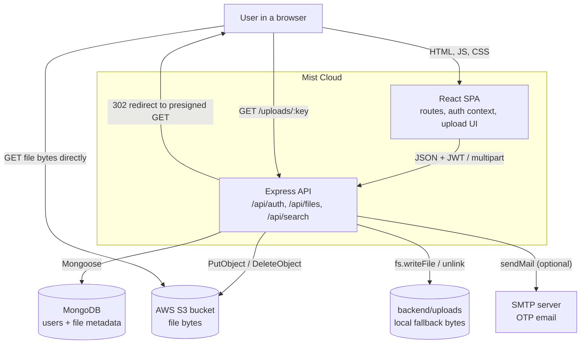
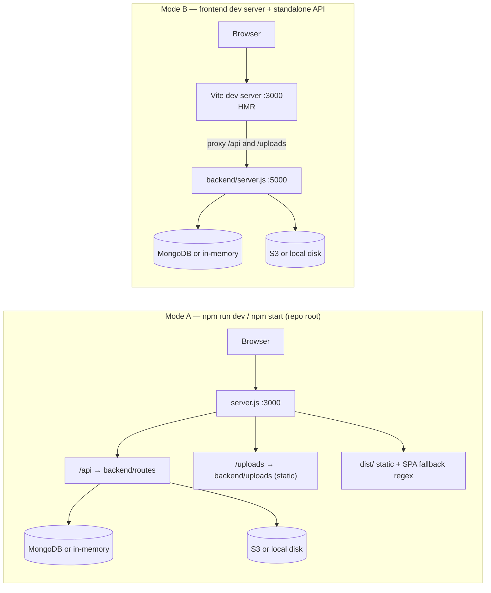
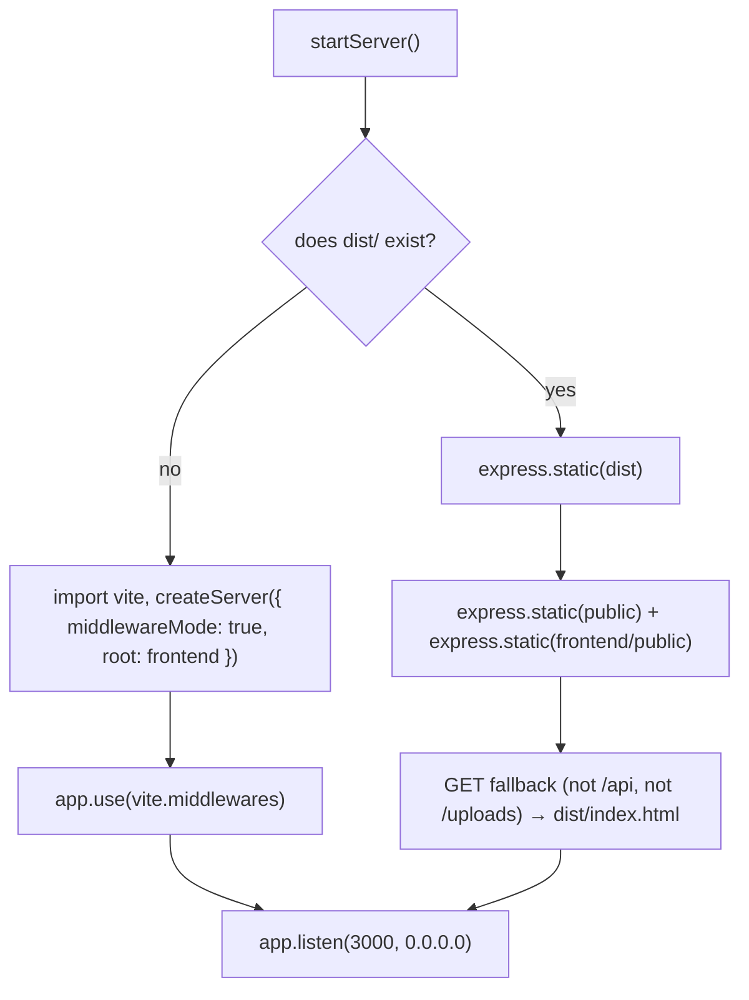
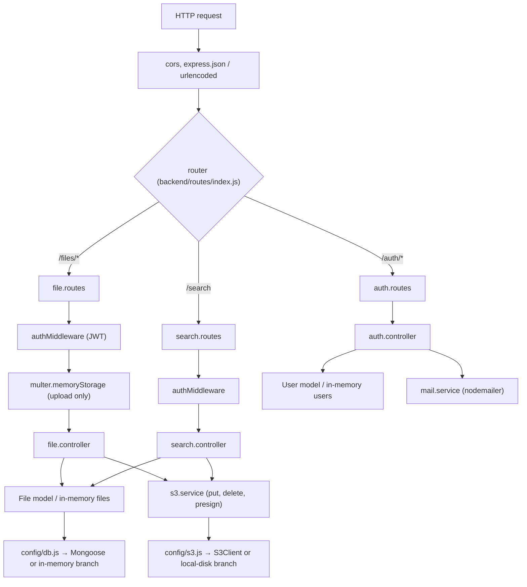

# 01 — System Architecture

## 1. What this project is

Mist Cloud ("Cloudy") is a small personal cloud-storage web app:

- Users sign up / sign in with email + password, then confirm a 6-digit OTP.
- Authenticated users upload files (≤ 50 MB), browse them by category, search, sort,
  rename, share by email, download / open, and delete.
- A dashboard shows storage usage (2 GB quota, hardcoded) broken down by file type.

## 2. Technology actually in use

Versions come from the root [`package.json`](../package.json) — the root `node_modules` is the
one used when you run `node server.js` from the repo root.

| Layer | Technology | Where |
| --- | --- | --- |
| UI | React 19, React Router 7, Tailwind CSS 4, sonner, react-dropzone | `frontend/src` |
| Build | Vite 8 (`outDir: ../dist`), TypeScript | `frontend/vite.config.ts` |
| HTTP client | Axios with request/response interceptors | `frontend/src/api` |
| API | Express 5, CORS, `express.json({limit:'50mb'})` | `server.js`, `backend/` |
| Auth | `bcryptjs` (password), `jsonwebtoken` (30-day JWT), custom OTP | `backend/controllers/auth.controller.js` |
| Mail | `nodemailer` (SMTP, optional) | `backend/services/mail.service.js` |
| Upload | `multer` memory storage, 50 MB limit | `backend/middleware/upload.middleware.js` |
| Metadata DB | MongoDB via Mongoose 9 (optional) | `backend/models`, `backend/config/db.js` |
| Blob storage | AWS S3 via `@aws-sdk/client-s3` + presigner (optional) | `backend/services/s3.service.js` |
| Fallbacks | In-process `Map`/array store, local disk `backend/uploads` | `backend/config/inMemoryStore.js` |

Dependencies present but **not imported anywhere in `backend/` or `frontend/src/`**:
`@upstash/vector`, `groq-sdk`, `pdf-parse`, `node-appwrite`, `recharts`, `@radix-ui/*`,
`react-hook-form`, `@hookform/resolvers`, `zod`, `use-debounce`, `input-otp`, `lucide-react`
(root). They are leftovers from the Next.js/Appwrite/AI version of the app.

## 3. System context

**In plain words.** Picture a shop: the browser is the shop front, the Express API is the back room, and three storerooms sit behind it.

- The **React app** is what the user sees and clicks. It turns every click into a request: JSON for logins, lists, renames and deletes; a file upload for new files.
- The **Express API** is the only part allowed into the storerooms. It checks the user's token, decides what is allowed, then calls the right service.
- **MongoDB** holds index cards — file name, size, category, owner, who it is shared with. No file content lives here.
- **S3** (or `backend/uploads` when AWS keys are missing) holds the actual bytes.
- **SMTP** is used for one thing only: emailing the login code. If it is not configured, the code is printed in the server log instead.

The last three arrows are the interesting part. When a user opens a file and S3 is in use, the API does **not** stream the bytes. It replies `302` with a temporary signed S3 link, and the browser fetches the file straight from S3. With local disk there is nothing to redirect to, so Express streams the bytes itself.

## 4. Runtime topology — two entry points

The repo can be started two different ways, and they are not equivalent.

**In plain words.** There are two ways to start this project, and they behave differently.

- **Mode A — one process.** `server.js` on port `3000` is the whole app: it answers `/api/*`, serves uploaded files from `/uploads`, and serves the compiled frontend from `dist/`. This is what `npm run dev` and `npm start` give you, and it is closest to how the app would be deployed.
- **Mode B — two processes.** Vite runs the frontend on `3000` with hot reload, and `backend/server.js` runs the API on `5000`. Vite's proxy forwards `/api` and `/uploads` to `5000`, so the browser still talks to a single origin and no CORS problem appears.

The catch: root `npm run dev` builds the frontend first and then starts Mode A. Editing a React file does nothing until you rebuild — it is not the hot-reload loop people expect. For that, start Vite in `frontend/` and nodemon in `backend/` separately.

How `server.js` decides (root):

**In plain words.** This is the first decision the server makes at boot: *is there a compiled frontend to serve?*

- **`dist/` exists** → serve it as static files. Any URL that is not `/api` or `/uploads` returns `dist/index.html`. That last rule is what makes client-side routing work: `/images` is not a real file, so the server hands back the app shell and React Router shows the images page.
- **`dist/` does not exist** → start Vite in middleware mode inside Express. Vite compiles `.tsx` on demand and adds hot reload, so no separate build step is needed.
- Either way the process ends up listening on `0.0.0.0:3000`.

Because `npm run dev` runs `vite build` first, the second branch is effectively dead in normal use — `dist/` is always there by the time the server starts.

Consequences worth knowing:

1. `npm run dev` **builds first** (`vite build frontend && node server.js`). There is no HMR, and
   every frontend edit needs a rebuild. The Vite-middleware branch is effectively unreachable
   with that script because `dist/` always exists afterwards.
2. `frontend/vite.config.ts` proxies `/api` and `/uploads` to `:5000`, but the root dev script
   never starts the `:5000` server. Running plain `vite` therefore needs the backend started
   separately (`cd backend && npm run dev`, nodemon) — otherwise every request 404s/ECONNREFUSED.
3. Root and `backend/` declare different dependency versions (root: Express 5, Mongoose 9;
   `backend/package.json`: Express 4, Mongoose 8). Whichever `node_modules` resolution wins
   determines behavior. The root install is the one exercised by `npm run dev`.

## 5. Backend layering

**In plain words.** A request walks down this stack like a visitor in an office building.

1. **Reception** (`cors`, `express.json`) decides which websites may call, and unpacks the JSON body (or multipart form data for uploads).
2. **Switchboard** (`backend/routes`) sends the request to the auth, file or search router based on the URL.
3. **Security guard** (`authMiddleware`) reads the `Authorization: Bearer …` header (or `?token=`), verifies the JWT and loads the user. No user, no entry.
4. **Mailroom** (`multer`) exists only on the upload route: it catches the uploaded file and holds it in memory.
5. **Worker** (the controller) does the real job: classify the file, save it, list it, rename it, delete it.
6. **Records and warehouse**: the controller writes metadata through a Mongoose model and bytes through `s3.service`.

Every controller then has a fork: if Mongo is connected it uses Mongoose, otherwise the in-memory store; if S3 is configured it uses the SDK, otherwise the disk. That fork is why the same feature has two code paths everywhere.

`backend/config/inMemoryStore.js` is not a "cache": it is a full alternative data layer with the
same surface the controllers expect (`findUserByEmail`, `createUser`, `getFiles`, `createFile`,
`findFileById`, `updateFile`, `deleteFile`). Every controller branches on
`mongoose.connection.readyState === 1` first, then falls back to it.

## 6. HTTP API surface

All routes are mounted under `/api`. 🔒 = requires `Authorization: Bearer <JWT>`
(or `?token=<JWT>`).

| Method & path | Body / query | Returns | Notes |
| --- | --- | --- | --- |
| `POST /auth/signup` | `{email, fullName, password}` | `{accountId}` | Hashes password, sets OTP `123456`, tries to email it. |
| `POST /auth/signin` | `{email, password}` | `{accountId}` | `password123` bypasses the bcrypt check when Mongo is up; auto-provisions users in memory mode. |
| `POST /auth/resend-otp` | `{email}` | `{accountId}` | Always resets OTP to `123456`; no email sent. |
| `POST /auth/verify` | `{accountId, password: <otp>}` | `{token, sessionId, user}` | Accepts `123456` **or** the stored OTP. Signs a 30-day JWT. |
| `GET /auth/me` 🔒 | — | user (no password/OTP) | Used on app boot to restore the session. |
| `GET /auth/users/:id` | — | user | **Public**; used to show file owners. |
| `POST /files/upload` 🔒 | multipart `file` | file doc (201) | Classifies by extension, uploads bytes, writes metadata. |
| `GET /files` 🔒 | `types, searchText, sort, limit` | `{total, documents[]}` | `types` is comma-separated. `sort` is `field-order`. |
| `GET /files/usage` 🔒 | — | `TotalSpace` | Aggregated sizes per type + latest date, `all = 2 GB`. |
| `PATCH /files/:id/rename` 🔒 | `{name, extension}` | file doc | Appends the extension if missing. |
| `PATCH /files/:id/share` 🔒 | `{emails: string[]}` | file doc | Replaces the whole share list (deduped). |
| `DELETE /files/:id` 🔒 | — | `{status:'success'}` | Deletes blob then metadata. |
| `GET /files/:id/download` 🔒 | `inline=true` \| `view=true`, `token` | 302 to presigned S3 URL, or streamed file | This is how cards "open" a file. |
| `GET /search` 🔒 | `query` | `FileDoc[]` (≤10) | Regex over `name`, `type`, `extension`. |
| `GET /health` and `/api/health` | — | status JSON | Root server and router each define one. |

Errors: controllers call `next(error)`; `error.middleware.js` logs and responds
`{success:false, error, stack?}`, using `res.statusCode` if it was already set. A 404 handler
covers unknown routes.

## 7. Configuration

| Variable | Used by | Missing → behavior |
| --- | --- | --- |
| `MONGODB_URI` | `backend/config/db.js` | In-memory store, no persistence |
| `AWS_ACCESS_KEY_ID`, `AWS_SECRET_ACCESS_KEY`, `AWS_S3_BUCKET_NAME` | `backend/config/s3.js` | Local disk `backend/uploads`, URLs `/uploads/<key>` |
| `AWS_REGION` | S3 client | defaults `us-east-1` |
| `JWT_SECRET` | auth controller + middleware | hardcoded fallback `super_secret_cloudy_jwt_key_12345!` |
| `SMTP_HOST`, `SMTP_PORT`, `SMTP_USER`, `SMTP_PASS`, `SMTP_FROM` | `mail.service.js` | OTP printed to the server console |
| `CLIENT_URL` | `backend/server.js` CORS | `http://localhost:5173` |
| `PORT` | `backend/server.js` | `5000` (root `server.js` ignores it: always `3000`) |
| `VITE_API_URL` | `frontend/src/api/axios.ts`, `files.ts` | `/api` (same-origin) |
| `NODE_ENV` | error handler | stack traces included when not `production` |

Root `.env` is loaded explicitly from the repo root by `server.js`, `s3.js` and `mail.service.js`,
so the same file drives both entry points.
