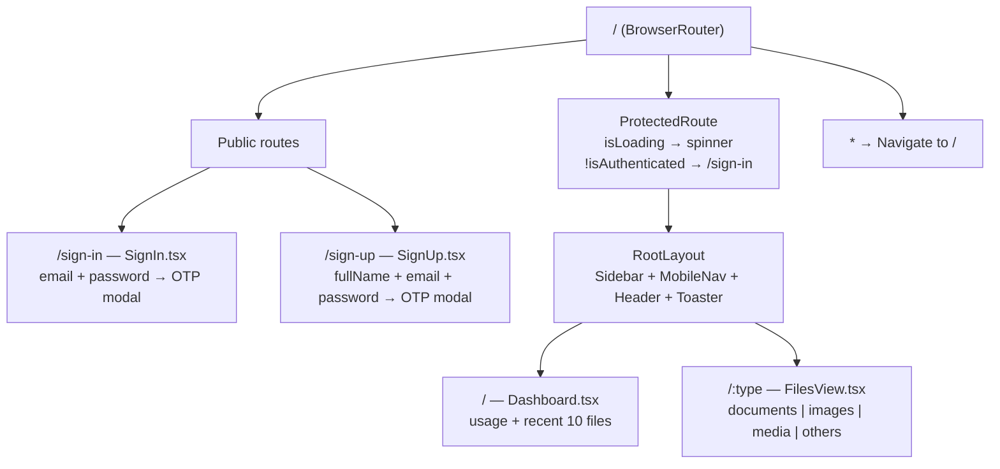
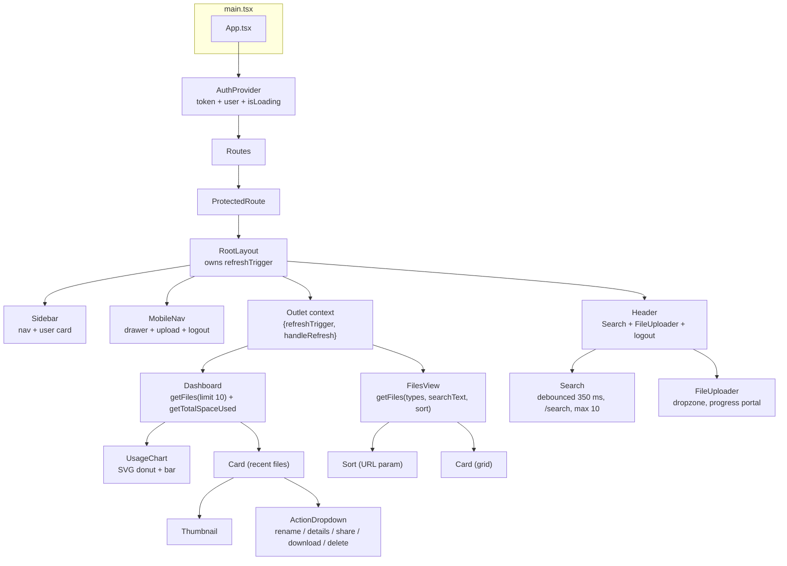
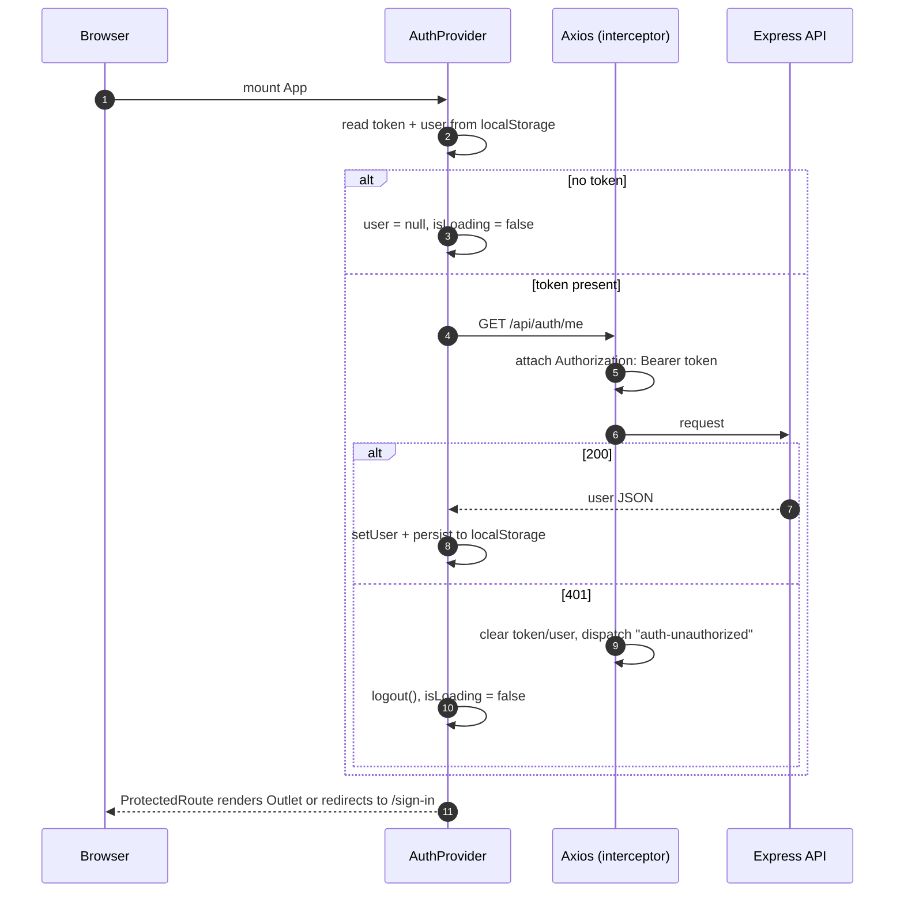
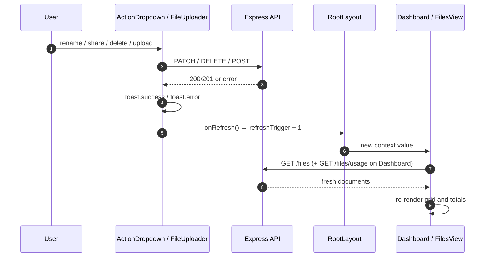
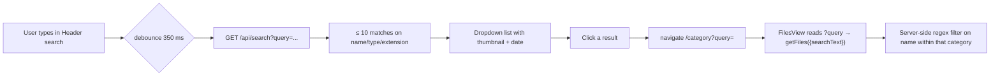

# 02 — Frontend Map

## 1. Route tree

Routing is client-side (React Router 7, `BrowserRouter`). In production the Express server
returns `dist/index.html` for any non-API GET, so deep links work.



**In plain words.** The app has two zones.

- **Public pages** — `/sign-in` and `/sign-up`. Anyone can open them.
- **Guarded pages** — everything behind `ProtectedRoute`. While the app is still checking the saved token it shows a spinner; if there is no valid session it redirects to `/sign-in`; otherwise it renders the shared layout with the sidebar, header and page content.
- **Anything else** — an unknown URL simply sends you back to `/` instead of showing a 404.

Inside the guarded area there are only two real screens: the dashboard (`/`) and one category page (`/:type`). The category page is reused four times — `documents`, `images`, `media` and `others` — and the URL segment is translated into the `types` value the API expects. A side effect: any other segment (say `/foo`) is treated as *no filter*, so it shows every file.

`/:type` is a single parameterised page. [utils/index.ts](../frontend/src/utils/index.ts)
`getFileTypesParams()` maps the URL segment to API `types`:

| URL | `types` sent to API | Sidebar label |
| --- | --- | --- |
| `/documents` | `document` | Documents |
| `/images` | `image` | Images |
| `/media` | `video,audio` | Media |
| `/others` | `other` | Others |

Any other value (e.g. `/foo`) still renders `FilesView` with an empty type list, which the API
interprets as "no type filter" — so it shows every file.

## 2. Component tree and responsibilities



**In plain words.** Read the tree top to bottom: each arrow means *renders*.

- `App` wraps everything in `AuthProvider`, so any component can ask who is logged in.
- `ProtectedRoute` acts as the door, then `RootLayout` draws the persistent shell: sidebar, mobile drawer, header with search and upload button, toast container.
- The shell also owns one small piece of state, `refreshTrigger`, and hands it plus `handleRefresh` to whichever page is showing through the router's `Outlet` context.
- `Dashboard` shows usage plus the ten newest files; `FilesView` shows one category with sorting and search. Both use `Card`, which uses `Thumbnail` for the preview and `ActionDropdown` for rename, details, share, download and delete.

So the shell owns *when to refresh*, pages own *what to fetch*, and cards own *what can be done to one file*.

Data ownership:

| State | Owner | Why it matters |
| --- | --- | --- |
| `token`, `user`, `isLoading` | `AuthContext` (localStorage mirror) | Any 401 from Axios clears them and fires `auth-unauthorized`. |
| `refreshTrigger` | `RootLayout` | A counter passed through `Outlet` context. Uploading or mutating a file calls `handleRefresh()`, which increments it; both pages re-run their fetch effects. |
| `searchText`, `sort` | URL query string (`?query=`, `?sort=`) | Shareable/back-button friendly; `Search` and `Sort` write to it, `FilesView` reads it. |
| Upload progress list | `FileUploader` local state | Rendered through a portal to `document.body`. |
| Modal state (`rename`/`details`/`share`/`delete`) | `ActionDropdown` local state | Rendered as a full-screen portal overlay. |

## 3. Session bootstrap and refresh loop



**In plain words.** Refresh the page and the app has to remember who you are.

1. It reads `token` and `user` from `localStorage`.
2. No token → treated as signed out immediately.
3. Token present → it calls `GET /api/auth/me` with the token in the header, to confirm the token is still valid and to get fresh user data.
4. `200` → the user is stored again and the guarded pages render. The user never sees a login screen.
5. `401` → the interceptor deletes the stored token and user, emits `auth-unauthorized`, the context logs out, and the guard sends you to `/sign-in`.

The same interceptor runs on every later request, so an expired or revoked token logs the user out on their next action rather than at a fixed clock time.

The same 401 handling applies to every later request, so an expired 30-day token logs the user out
on the next call rather than at a fixed time.

## 4. How the UI stays in sync after a mutation



**In plain words.** There is no cache and no optimistic update; the app simply asks again.

1. The user renames, shares, deletes or uploads.
2. The component calls the API and shows a success or error toast.
3. On success it calls `onRefresh()`, which increments `refreshTrigger` in `RootLayout`.
4. That new value flows through the outlet context to the current page, whose effect depends on it.
5. The page re-runs `GET /files` (and `/files/usage` on the dashboard) and re-renders.

It is blunt but predictable: the screen always reflects what the server just returned, at the cost of one extra round trip after every change.

There is no client-side cache and no optimistic update: every mutation is followed by a re-fetch.
`Dashboard` fetches recent files and usage in parallel with `Promise.all`, `FilesView` computes its
"Total Size" by summing the returned documents locally.

## 5. Search behaviour (two different searches)



**In plain words.** Search happens twice, on purpose.

- While typing, the header waits 350 ms after the last keystroke, then asks `/api/search`. That endpoint returns at most ten quick matches across all categories, shown as a dropdown with a thumbnail and date. It is a preview, not the real result set.
- Clicking a result navigates to that file's category page with `?query=<file name>`.
- `FilesView` reads `query` from the URL and calls `/api/files` with `searchText`, which filters server-side by file name inside that category.

So the dropdown helps you find the file, and the page you land on shows the filtered list. Because the query travels in the URL, the result is shareable and the back button behaves normally. In short: the header dropdown is a *preview* (limit 10, cross-category); the page you land on performs the real filtered fetch. Clicking a shared document that lives under a different category still works
because the redirect targets the file's own type.

## 6. Opening and downloading a file

`Card` opens `getFileViewUrl(file)` in a new tab; that helper builds

```
/api/files/<id>/download?token=<JWT>&inline=true
```

The token is a **query parameter** here because a plain `window.open` cannot set headers. The
backend middleware explicitly accepts `req.query.token` for this reason. `ActionDropdown`'s
Download uses the same URL without `inline`.

## 7. Styling and UI primitives

- Tailwind 4 via `@tailwindcss/vite`; design tokens (`bg-brand`, `text-light-100`, `shadow-drop-1`,
  `h1`, `subtitle-2`, `primary-btn`, `file-card`, `sidebar`, …) are defined in
  [frontend/src/index.css](../frontend/src/index.css).
- Icons are static SVGs under `frontend/public/assets`, referenced by absolute path.
- Toasts: `sonner` (`<Toaster richColors position="top-right" />` in `RootLayout`).
- `UsageChart` is hand-rolled SVG (a donut using `stroke-dasharray` plus a bar). `recharts` is
  installed but not imported.
- No component library is used at runtime; Radix packages in the root `package.json` are unused.
