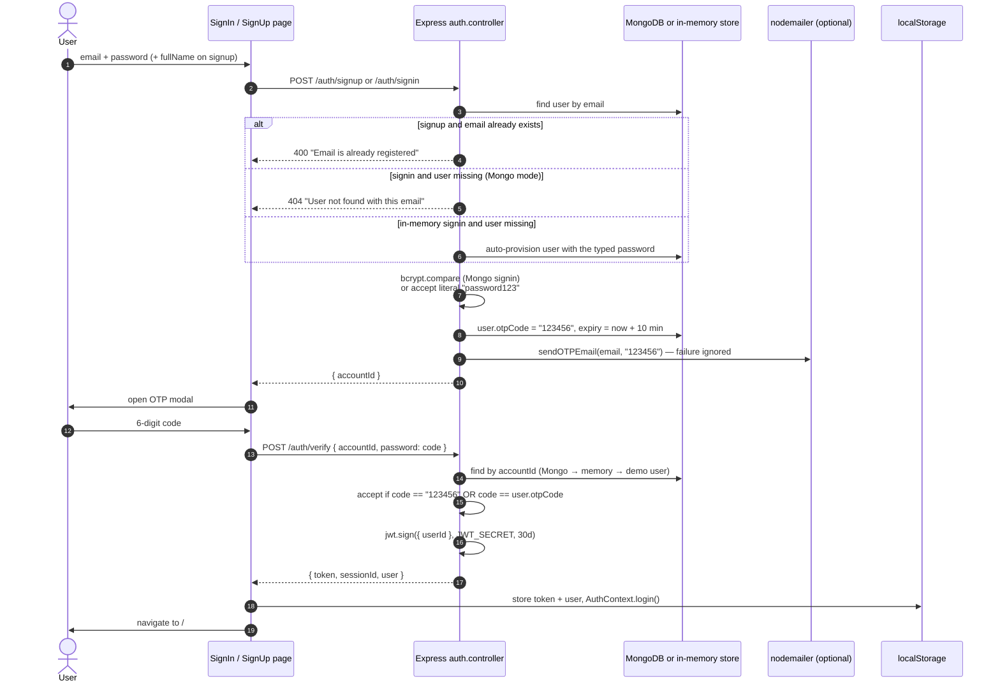
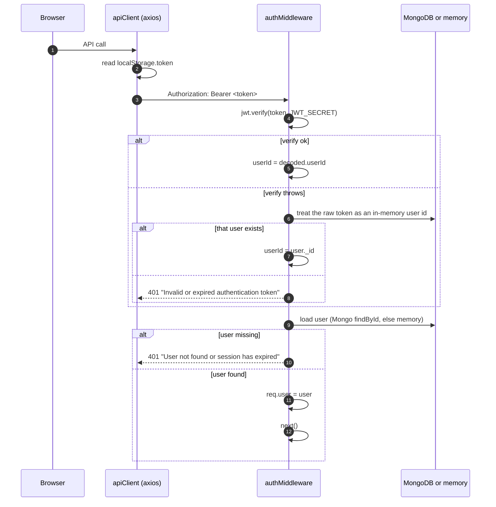
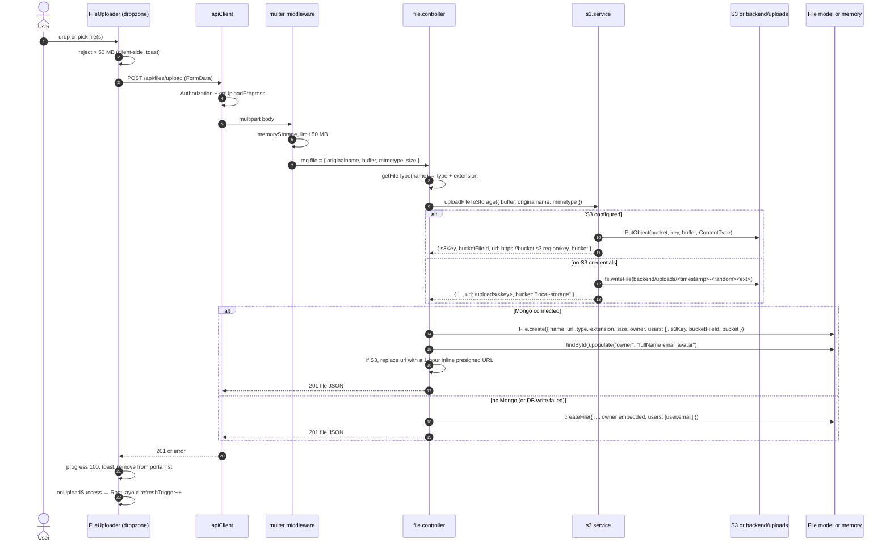
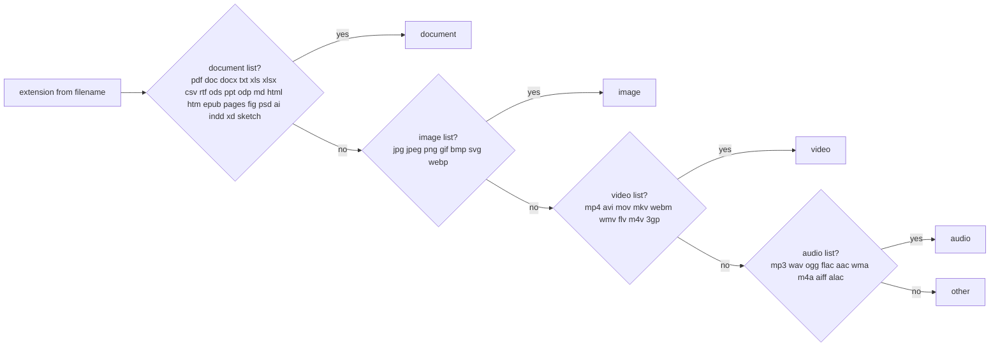
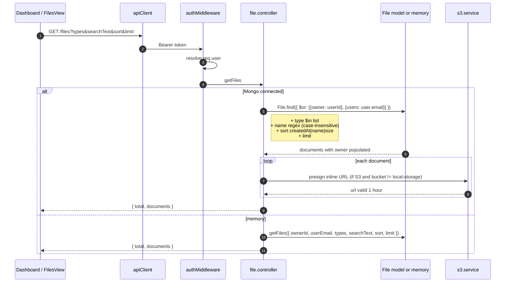
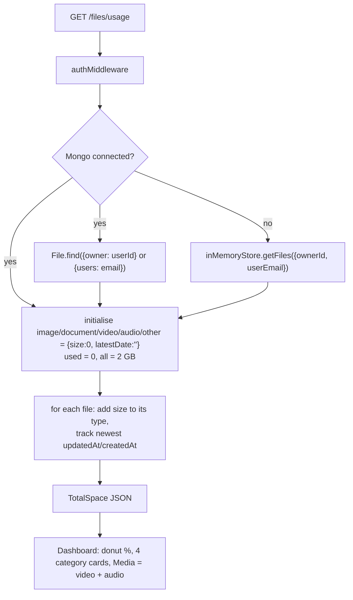
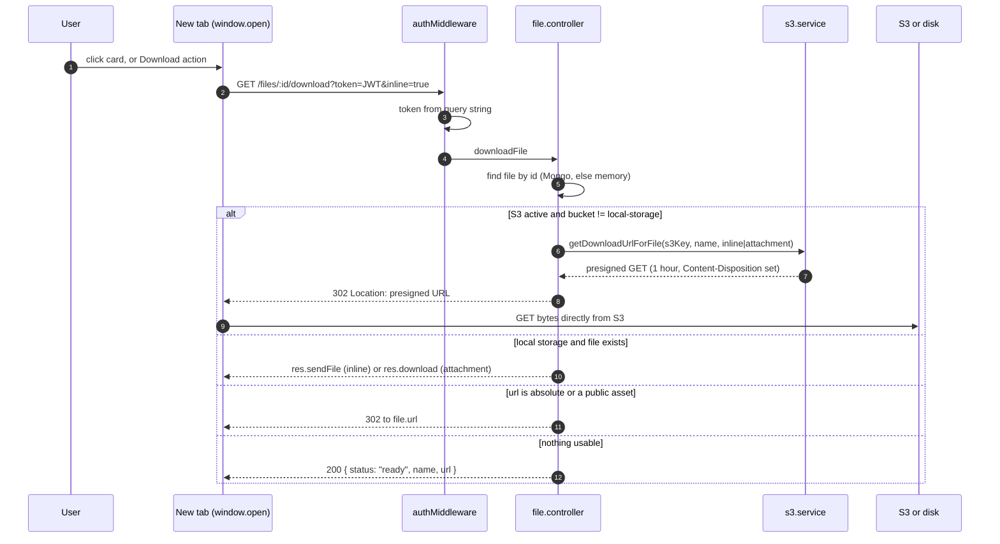
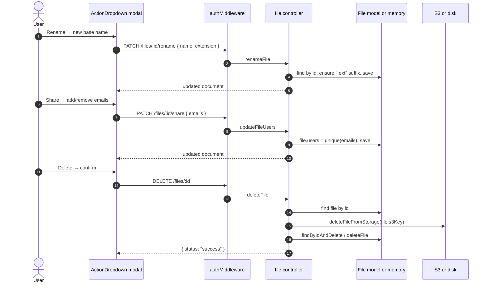
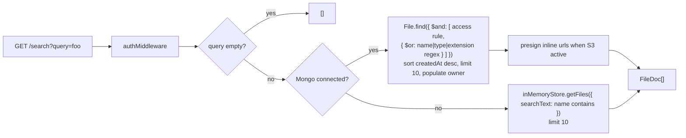
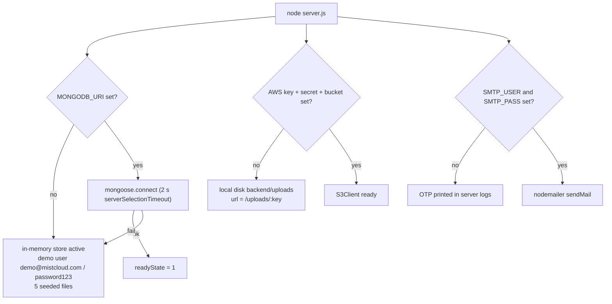

# 03 — Workflows (step by step)

Every workflow below is traced from the actual controllers. Where the Mongo path and the in-memory
path differ, both are shown.

## 1. Authentication: password, then OTP, then JWT

**In plain words.** Login is a three-act play: password, code, badge.

1. The form sends email + password (plus full name on signup).
2. The server looks the user up. Signup refuses an existing email; signin in Mongo mode refuses an unknown one; in memory mode an unknown email is created on the spot.
3. It checks the password with `bcrypt.compare` — bcrypt stores a scrambled hash, never the password itself. (It also accepts the literal string `password123`, which is a serious hole.)
4. It writes a one-time code and a 10-minute expiry on the user record, then tries to email the code. Mail failure is ignored.
5. The response is only `{ accountId }`, so the UI opens the code dialog.
6. The user submits the code to `/auth/verify`. The server finds the user, accepts `123456` or the stored code, and signs a JWT containing the user id, valid 30 days.
7. The browser saves the token and user in `localStorage`, the auth context updates, and the app navigates to the dashboard.

Put simply: the password proves *something you know*, the code is supposed to prove *you own the inbox*, and the JWT is the wristband you wear for the next 30 days. In this code the code is always `123456` and its expiry is never checked, so the wristband is effectively free — see `05-findings.md`.

Key properties of this implementation:

- **The OTP is a constant.** `123456` is set on signup, signin and resend, and the UI even prints
  "(Default code: 123456)". Email delivery is cosmetic; verification succeeds without it.
- `accountId` is the MongoDB `_id` (or the in-memory id). It is not a secret — it is returned to
  anyone who knows the email address and any password accepted by signin.
- The JWT lasts 30 days. There is no refresh token, no revocation list, no logout endpoint.
- Signup with Mongo stores a bcrypt hash (cost 10). Signup in memory mode stores the hash too, but
  the in-memory signin path never compares it (it auto-provisions or accepts anything).

### Token use on every subsequent request

**In plain words.** This is the bouncer every protected route must pass.

1. Axios reads the token from `localStorage` and adds `Authorization: Bearer <token>`.
2. `authMiddleware` verifies the signature with `JWT_SECRET`. A JWT is just a small JSON object plus a signature — if the signature matches, the server believes the contents without a database lookup.
3. If verification succeeds, the user id comes from the token payload.
4. If verification fails, the middleware tries a second, looser interpretation: treat the raw string as an in-memory user id. That keeps demo mode working without real tokens.
5. It then loads the user (Mongo first, memory second). No user → `401`.
6. On success it attaches `req.user` and calls `next()`, so the controller can trust `req.user`.

The middleware also reads `?token=` from the query string. That exists so `window.open` can download a file without custom headers, but it means tokens can end up in browser history, referrers and logs.

The `?token=` query parameter is accepted as well, which is what makes `window.open` downloads and
inline previews work. It also means JWTs end up in URLs (browser history, referrer headers, logs).

## 2. Upload

**In plain words.** Upload has two separate jobs: move the bytes, then write the index card.

1. The dropzone rejects anything over 50 MB before sending.
2. Axios posts multipart form data with the token attached and reports progress.
3. `multer` receives the body and keeps the whole file in RAM (memory storage), not on disk.
4. The controller reads the extension to decide the category and builds a storage key from timestamp + random bytes + extension. The original filename is never used as a path, which prevents collisions and path traversal.
5. `s3.service` writes the bytes: `PutObject` to S3 if keys exist, otherwise `fs.writeFile` into `backend/uploads`.
6. Then metadata is written: with Mongo via `File.create` and `populate('owner')`, otherwise into the in-memory array with the owner object embedded.
7. The response is the file document; the UI shows a toast, removes the progress row, then bumps `refreshTrigger` so the list re-fetches.

Note the cost: the file passes *through* the API process, so a 50 MB upload occupies roughly 50 MB of server RAM while it is being forwarded to S3. There is no direct browser-to-S3 upload here.

Notes:

- The file bytes pass **through** the API process: multer buffers the whole file in memory, then
  the S3 SDK re-uploads it. Memory use ≈ one file per concurrent upload (up to 50 MB each).
- The storage key is `Date.now() + 8 random bytes + original extension`; the original filename is
  never used as a key, so collisions and path traversal are avoided.
- `bucketFileId` duplicates `s3Key` in this implementation (it is an Appwrite leftover).
- In-memory files carry an embedded owner object and their own email in `users`, which is why the
  demo user sees the seeded files.

### Extension → category

**In plain words.** This is sorting mail into trays. The server looks only at the letters after the last dot in the filename.

- On the document list → `document`
- On the image list → `image`
- On the video list → `video`
- On the audio list → `audio`
- Nothing matches → `other`

The category is stored on the file record and is what the sidebar tabs filter on, so a `.pdf` always appears under Documents and a `.mp4` under Media. There is no content sniffing: renaming `song.mp3` to `song.pdf` changes its category. The same list exists in the frontend to pick an icon during upload, and the two copies can drift slightly.

This function exists twice: `backend/controllers/file.controller.js` (authoritative, stored in the
DB) and `frontend/src/utils/index.ts` (used for the optimistic thumbnail while uploading). The two
lists are nearly identical but drift slightly (frontend omits `pptx` from its extra list and adds
nothing else); any divergence changes only the icon shown during upload.

## 3. Listing files (every page load)

**In plain words.** Every page load asks one question: *which files may this user see?*

1. The page calls `GET /api/files` with an optional category list, search text, sort field/order and limit.
2. The guard resolves the user from the token.
3. The controller builds the access filter: files where `owner` is this user **or** the share list `users` contains this user's email.
4. On top of that it applies the category filter, a case-insensitive name search, sorting (`createdAt`, `name` or `size`) and the limit.
5. Each returned file gets its `url` refreshed: in S3 mode a new one-hour signed link per file; in local mode the stable `/uploads/<key>` path.
6. The page receives `{ total, documents }` and renders one card per document.

Because listing, usage and search all reuse that same filter, sharing behaves consistently everywhere. The only extra work per page load is signing URLs — one call per file, with no caching.

Access rule (identical in list, usage and search): **owner `_id` matches** OR **`users` array
contains the requester's email**. `users` is the share list.

## 4. Storage usage (Dashboard)

**In plain words.** This is a tally, not a database query.

1. The dashboard asks `GET /api/files/usage`.
2. The server loads every file the user can see, using the same owner-or-shared rule.
3. It starts five counters at zero — image, document, video, audio, other — each with a size and a latest date, plus a grand total and a limit.
4. For each file it adds the size to its category and remembers the newest date.
5. It returns the totals; the dashboard draws a donut and four cards, where *Media* is video + audio added together.

Two caveats: `all` is hardcoded to 2 GB and nothing enforces it, so the donut can pass 100%; and a file shared with three people counts fully in all three accounts' usage.

Quota handling is display-only: `all` is always `2 * 1024 * 1024 * 1024`, and nothing in upload
rejects a file that would exceed it. The same 2 GB constant is duplicated in
`frontend/src/utils/index.ts` (`calculatePercentage`) and in `Dashboard.tsx`'s initial state.

## 5. Download / open

**In plain words.** Opening a file and downloading it are the same endpoint with a different flag.

1. The card opens `/api/files/:id/download?token=<JWT>&inline=true` in a new tab; the download action uses the same URL without `inline`.
2. The guard accepts the token from the query string because a plain `window.open` cannot send headers.
3. The controller loads the file record.
4. **S3 mode:** it asks the SDK for a presigned `GetObject` URL — a temporary link that already contains permission — sets `Content-Disposition` to inline or attachment, and replies `302`. The browser then downloads from S3 directly.
5. **Local-disk mode:** Express sends the file with `sendFile` (inline) or `download` (attachment).
6. If the record only holds a plain public URL, it redirects there; if nothing is usable it returns a small JSON placeholder.

The signed URL is valid for an hour and is not tied to the user after it is issued: anyone who copies it can fetch the file until it expires. That is also why each listing has to mint new links.

In S3 mode the bytes never transit the API for downloads — only metadata does. In local-disk mode
they stream through Express. Note that the presigned URL is valid for an hour and is not tied to
the requesting user once issued.

## 6. Rename, share, delete

**In plain words.** Three small operations, each one request.

- **Rename** sends a new base name and the existing extension; the controller looks up the file, appends `.ext` if it is missing, and saves. Only the display name changes — the storage key and the bytes stay put.
- **Share** sends the complete list of emails. The controller lowercases and de-duplicates it, stores it in `users`, and returns the file. There is no invitation and no notification: the next time that person loads their list, the file is there.
- **Delete** looks up the file, deletes the blob (`DeleteObject` in S3 or `unlink` on disk), then removes the metadata. It is immediate and there is no trash.

The gap: none of these three checks that the caller owns the file. A valid token is enough, so anyone who knows a file id can rename, re-share or delete it — while listing and search are properly scoped.

**Authorization gap:** the only check is "is there a valid JWT". `renameFile`, `updateFileUsers` and
`deleteFile` never compare `file.owner` with `req.user`, so any signed-in user who knows (or guesses)
a file id can rename, re-share or delete it. Listing and search are correctly scoped; single-file
mutations are not.

Sharing has no acceptance step and no notification: adding an email immediately makes the file
appear in that user's list the next time they load it, and lets them delete it (see above).

## 7. Search

**In plain words.** Search is a text match, not semantic search.

1. The query arrives at `GET /api/search?query=…` behind the guard.
2. Empty query → an empty array, no database work.
3. **Mongo mode:** one query combining the access rule with a case-insensitive pattern over `name`, `type` and `extension`, newest first, at most ten, owner populated.
4. **Memory mode:** a simple lowercase *contains* on the name only, also capped at ten.
5. In S3 mode each hit gets a fresh inline signed URL so the thumbnail can load.

So typing `pdf` matches the type and extension in Mongo mode, but only filenames in memory mode. Either way the result is a short preview list; the real filtered listing happens on the category page you land on.

Differences between the two modes: Mongo searches `name`, `type` and `extension`; the in-memory
store searches only `name`. Mongo is case-insensitive via `$regex /i`; memory lowercases the query
and the filename.

## 8. Fallback decision tree (runs at boot and per request)

**In plain words.** At boot the app checks three sockets, like a power strip with backup batteries.

- **Database socket.** No `MONGODB_URI` → in-memory store with a demo user and five seed files. URI present → try to connect with a 2-second timeout; failure → fall back to memory too.
- **Storage socket.** AWS key, secret and bucket all present → S3 client. Anything missing → local `backend/uploads`, with URLs served from `/uploads`.
- **Mail socket.** SMTP user and password present → real email. Missing → the code is printed in the server log.

Every branch is caught, so a misconfigured server still starts and looks healthy. The tells are subtle: data disappears after a restart (memory), files vanish when the machine is rebuilt (local disk), and no email ever arrives. This is why the failure is described as *silent* — nothing in the UI says which mode is active.

Because every failure is caught, a misconfigured deployment looks like a working one. The only
visible clue is the server log line printed at boot, plus data that disappears on restart
(in-memory) or files that vanish when the container is rebuilt (local disk).

| Runtime mode | Users | File metadata | File bytes | OTP delivery |
| --- | --- | --- | --- | --- |
| Fully configured | MongoDB | MongoDB | S3 | Email |
| No Mongo | process memory (reset on restart) | process memory | S3 or disk | Email or console |
| No S3 | MongoDB or memory | MongoDB or memory | `backend/uploads` | Email or console |
| No Mongo + no S3 | process memory | process memory | `backend/uploads` | console |
| Everything missing | demo store + auto-provisioned users | demo + uploaded | local disk | console |
