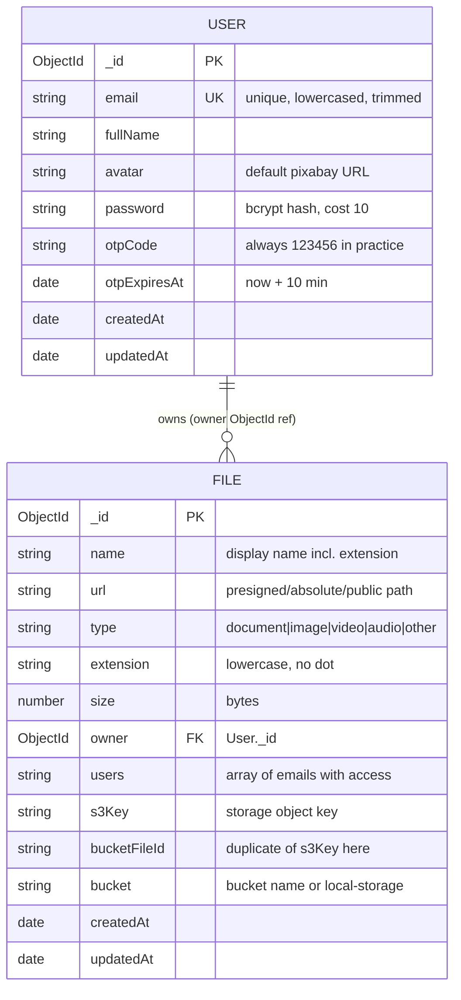
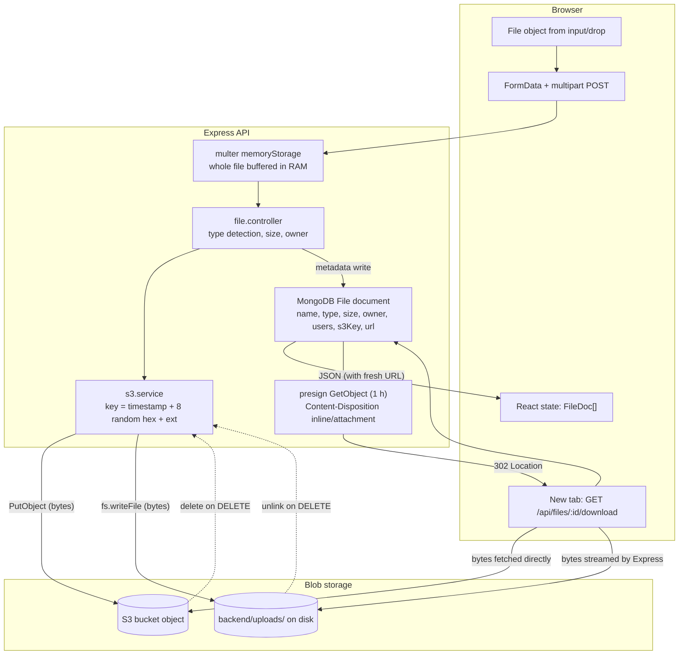
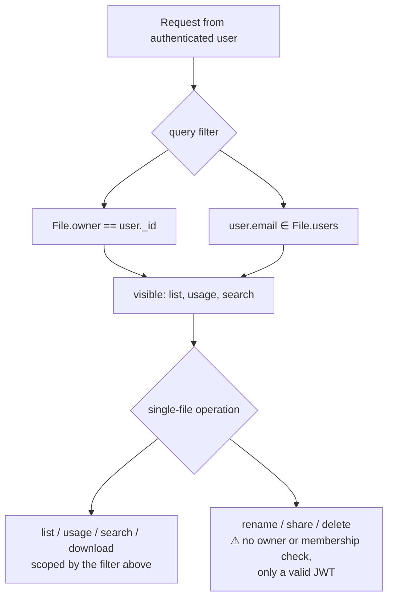
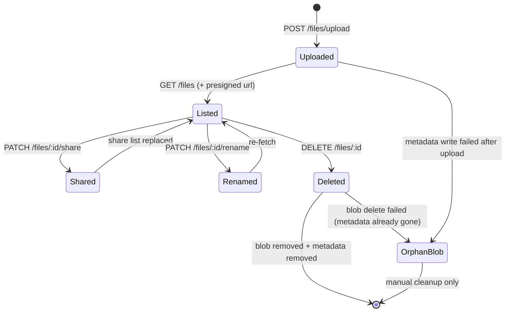

# 04 — Data Model & Data Movement

## 1. Entities

Two collections, one relationship. The relationship is **logical only** for sharing: `users` is a
plain array of email strings, not a reference to `User` documents.

**In plain words.** There are only two tables, and one link between them.

- **USER** — one row per account: email (unique), display name, avatar, the bcrypt password hash, the current OTP and its expiry. Password and OTP fields are stripped before the object is ever sent to the browser.
- **FILE** — one row per uploaded file: display name, type, extension, size, owner, the share list, and where the bytes live (`s3Key`, `bucket`, `bucketFileId`).
- The arrow means **one user owns many files**: `FILE.owner` stores the user's id. Mongo can *populate* that id into the full user object when listing, which is how the UI shows an owner name and avatar.
- `users` is **not** a link to the user table — it is a plain array of email strings. That array is the entire sharing model.

Think of USER as the membership desk and FILE as the item register. The register row never contains the file itself; it only says where to find it. Two conveniences follow: every document also exposes `$id`/`$createdAt` aliases because the frontend was originally written for Appwrite, and the in-memory store mimics the same shapes so controllers do not care which store is active.

Indexes declared on `File`:

| Index | Purpose |
| --- | --- |
| `{ owner: 1, type: 1 }` | list a user's files (optionally by category) |
| `{ users: 1 }` | "shared with me" lookups |
| `{ name: "text" }` | declared but unused — search uses `$regex`, not `$text` |

### API/JSON shape quirks

`User.toJSON` and `File.toJSON` add Appwrite-style aliases so the frontend can stay
backend-agnostic:

| Mongo field | JSON alias | Frontend usage |
| --- | --- | --- |
| `_id` | `$id`, `accountId` (user) | `file._id || file.$id` everywhere |
| `createdAt` | `$createdAt` | `file.createdAt || file.$createdAt` |
| `updatedAt` | `$updatedAt` | — |
| `password`, `otpCode`, `otpExpiresAt` | **removed** | never leaves the server |

The `FileDoc.owner` field is typed as `object | string` on the frontend because the in-memory
store embeds a full owner object while Mongo-populated documents also embed one — but `ownerId`
comparisons still work via `owner._id`/`owner.$id`.

### In-memory equivalent (`backend/config/inMemoryStore.js`)

| Concept | Mongo | In-memory |
| --- | --- | --- |
| Users | `users` collection | `Map` keyed by **both** `_id` and lowercased email (same object twice) |
| Files | `files` collection | module-level array; `createFile` unshifts |
| Owner | ObjectId + `populate` | embedded `{_id, $id, fullName, email, avatar}` |
| `users` (share list) | array of emails, starts `[]` | array of emails, starts `[ownerEmail]` |
| Persistence | durable | lost on restart |
| Seed data | none | `demo@mistcloud.com` / `password123` + 5 files |
| `save()` | Mongoose document method | no-op returning `this` |

Seed files deliberately point at bundled assets (`/Illustration.png`,
`/assets/icons/file-pdf.svg`, …) so the demo dashboard renders without any real storage.

## 2. Two kinds of data, two paths

The system moves two independent things: **bytes** (the file) and **metadata** (the record). They
travel on different paths, and only the metadata is transactional.

**In plain words.** Think of a parcel and its paperwork. The bytes are the parcel; the database row is the paperwork. They travel on separate lanes.

**Upload lane.** The browser sends the parcel to the API, the API puts it in storage (S3 or disk) and gets back a key, and only then writes the paperwork: name, size, type, owner and that key. The key is the bridge between the two lanes — the only thing that connects a row to its bytes.

**Read lane.** Listing reads only paperwork. When bytes are needed, the API signs a temporary link to the parcel and redirects; the browser collects the parcel from storage. In local mode the API hands the parcel over itself.

Because there are two lanes, there is no single transaction across them. If storage succeeds and the database write fails, a parcel sits in the warehouse with no paperwork (an orphan). If a delete removes the paperwork but the storage delete fails, the parcel is stranded. Downloads also explain the repeated signing: the paperwork does not store a permanent public link, only a key.

Consequences of this split:

- Metadata listing is cheap (Mongo) but each listed file triggers a **presign call**, so a page of
  N files costs N signing operations (no caching).
- The stored `url` is a *snapshot*: for S3 it is rewritten to a fresh 1-hour URL on every read;
  for local disk it is a stable `/uploads/<key>` path.
- Upload is not atomic across the two stores. If the metadata write fails after the blob upload,
  the object is orphaned in S3/disk (the controller falls back to memory and returns 201). If the
  blob delete fails, the metadata row is still removed in Mongo mode (`findByIdAndDelete` runs
  regardless of the delete result).
- `DELETE` in memory mode calls `deleteFileFromStorage` then removes the record; seed files have
  fake keys, so the storage delete is a no-op and the record disappears anyway.

## 3. Who can see which file

**In plain words.** Visibility is one rule, applied in one place.

- A file is visible if the requester **owns** it, or if their **email is in the share list**.
- That rule is used for listing, usage and search, so all three agree.
- Sharing adds an email; removing it takes access away on the next request. No acceptance step, no notification.
- The owner is not automatically in the share list, which is why the rule is an OR rather than a single check.

The right-hand branch is the problem: `rename`, `share` and `delete` do not run this rule at all. They only require a valid token. So *visibility* is enforced, but *modification* is not — a real authorization gap rather than a data-model quirk.

- Sharing is *additive by email*; removing an email removes access immediately.
- The owner is not automatically in `users`, so for Mongo-created files `users` is `[]` and the
  owner sees the file only through the `owner` branch. The in-memory upload path additionally puts
  the owner's email into `users`.
- `GET /auth/users/:id` is public, so owner names/avatars are readable by anyone who has an id.

## 4. File lifecycle

**In plain words.** A file's life is short and has no undo.

1. **Uploaded** — bytes written, metadata saved. The file now exists in two places: a blob and a row.
2. **Listed** — appears in someone's list, with a freshly signed URL each time.
3. **Shared / renamed** — the share list or the display name changes; bytes and key do not.
4. **Deleted** — blob removed, then metadata removed.
5. **Orphan** — a failure between the two stores leaves bytes without a record, or a record whose blob is gone. Nothing cleans these up automatically.

Because there is no trash, no version history and no restore, *delete* means *gone*. The only way a file comes back is a backup of S3 or Mongo that lives outside this app.

There is no trash, no versioning, and no restore. Delete is immediate and irreversible.

## 5. Sizes and limits as encoded

| Limit | Value | Enforced where |
| --- | --- | --- |
| Max upload | 50 MB | `multer` limit **and** client check in `FileUploader` (`MAX_FILE_SIZE`) |
| JSON body | 50 MB | `express.json({limit:'50mb'})` in both servers |
| Quota | 2 GB | displayed only (`getTotalSpaceUsed.all`, `calculatePercentage`) |
| Presigned URL TTL | 1 hour | `getSignedUrl(..., {expiresIn: 3600})` |
| OTP TTL | 10 minutes | `otpExpiresAt` — **never compared** during verification |
| JWT TTL | 30 days | `jwt.sign(..., {expiresIn:'30d'})` |
| Search results | 10 | `.limit(10)` / `limit: 10` |
| Dashboard recent files | 10 | `getFiles({ limit: 10 })` |
| Mongo connect timeout | 2 s | `serverSelectionTimeoutMS: 2000` |
