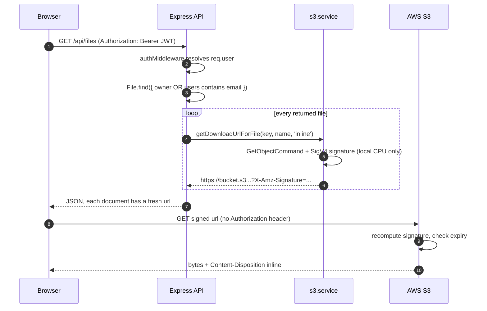
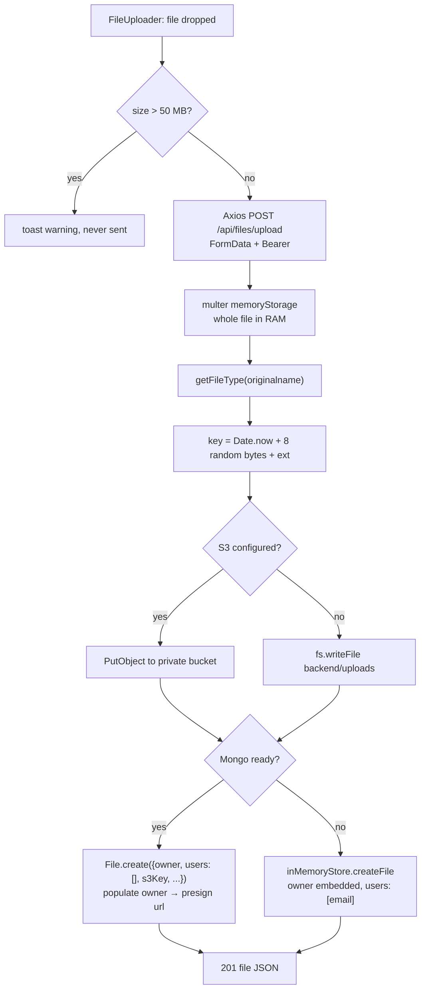
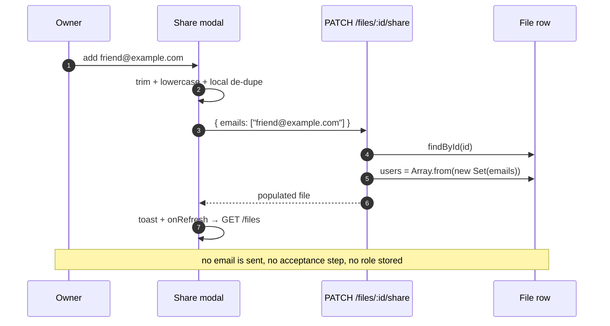
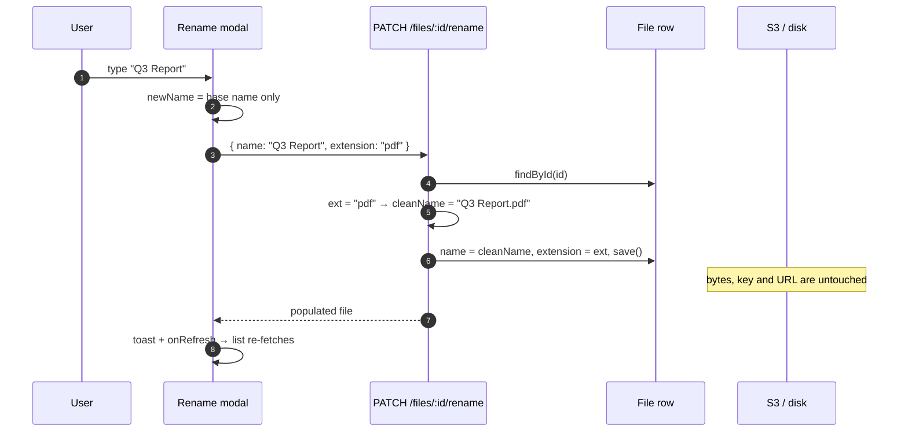
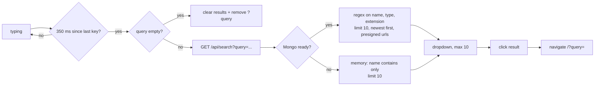
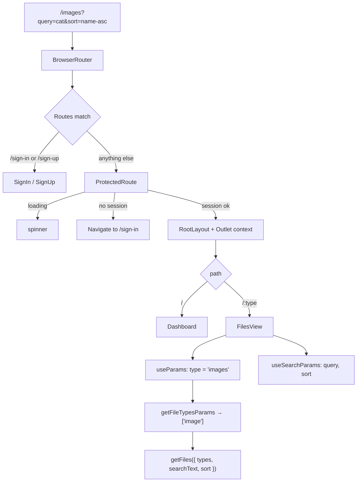
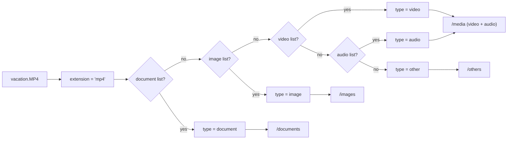

# 06 — Service Deep Dives

This file goes one level below the diagrams in `00`–`04`. For every service it answers: **what it
owns, where the code is, what happens step by step, what changes in the database, and what can go
wrong.** All statements are taken from the current source.

## Service map

| Service | Code | Owns | Talks to |
| --- | --- | --- | --- |
| S3 / storage service | `backend/services/s3.service.js`, `backend/config/s3.js` | Put, delete, presign; local-disk fallback | AWS S3, `backend/uploads` |
| Upload service | `backend/middleware/upload.middleware.js` + `file.controller.uploadFile` | Receiving bytes, 50 MB limit, key generation | multer, storage service, File model |
| File service | `backend/controllers/file.controller.js` | List, rename, share, delete, usage, download | File model, in-memory store, storage service |
| Access control | inside every file query (`$or` owner/shared) | Who may see a file | File model, `req.user` |
| Search service | `backend/controllers/search.controller.js` | 10-result preview search | File model, storage service |
| Auth service | `backend/controllers/auth.controller.js`, `middleware/auth.middleware.js` | Signup, signin, OTP, JWT, `/me` | bcrypt, jsonwebtoken, User model, mail |
| Mail service | `backend/services/mail.service.js` | OTP email or console fallback | SMTP |
| Data layer | `backend/config/db.js`, `models/*`, `config/inMemoryStore.js` | Persistence or demo fallback | MongoDB or process memory |
| HTTP server | `server.js`, `backend/server.js` | Ports, CORS, static files, SPA fallback | Express |
| Frontend API client | `frontend/src/api/*` | Token header, error handling, download URLs | Express |
| Routing | `frontend/src/App.tsx`, `pages/FilesView.tsx` | URL → page, dynamic category, query state | React Router |
| UI state | `context/AuthContext.tsx`, `components/RootLayout.tsx` | Session, refresh signal | React |

---

# 1. Storage service and presigned URLs

## 1.1 What the service does

`backend/services/s3.service.js` exposes exactly three functions:

| Function | Job | S3 command | Local fallback |
| --- | --- | --- | --- |
| `uploadFileToStorage({buffer, originalname, mimetype})` | write bytes, return a key | `PutObjectCommand` | `fs.writeFile` into `backend/uploads` |
| `getDownloadUrlForFile(s3Key, fileName, disposition)` | mint a temporary download link | `GetObjectCommand` + `getSignedUrl` | returns `/uploads/<key>` |
| `deleteFileFromStorage(s3Key)` | remove bytes | `DeleteObjectCommand` | `fs.unlink` |

`backend/config/s3.js` decides once, at require time, whether S3 is available:

```js
const isS3Configured = Boolean(
  process.env.AWS_ACCESS_KEY_ID &&
  process.env.AWS_SECRET_ACCESS_KEY &&
  process.env.AWS_S3_BUCKET_NAME
);
```

If all three exist it builds one `S3Client` for the whole process. Otherwise `s3Client` stays `null`
and every storage call takes the local branch. There is no retry and no partial mode: local disk and
S3 are all-or-nothing.

## 1.2 Upload: how the bytes actually move

The user's premise — "image moves from client to S3 using a presigned URL" — is **not** what this
code does. Upload is a server-side `PutObject`; only downloads are presigned. Both facts matter, so
here is the exact upload path:

1. `FileUploader` drops a file into local state and rejects anything over `MAX_FILE_SIZE` (50 MB).
2. `api/files.ts#uploadFile` builds `FormData`, posts to `/api/files/upload`, and reports progress
   through Axios's `onUploadProgress`.
3. `upload.middleware.js` uses `multer.memoryStorage()` with `limits.fileSize = 50 MB`. The **whole
   file is buffered in the Node process's RAM**.
4. `file.controller.uploadFile` reads `originalname` and calls `getFileType()` to get the category.
5. `s3.service#uploadFileToStorage` builds the key:
   ```js
   const uniqueKey = `${Date.now()}-${crypto.randomBytes(8).toString("hex")}${fileExtension}`;
   ```
   The user's filename is never part of the path, which prevents collisions and `../` traversal.
6. With S3 configured it sends `PutObject` with `Bucket`, `Key`, `Body` (the RAM buffer) and
   `ContentType` (the browser-reported MIME type). The bucket stays private; no ACL is set.
7. Without S3 it writes the same buffer to `backend/uploads/<key>` and stores `/uploads/<key>` as
   the URL.
8. Only **after** the bytes are stored does the controller write the metadata row.

So the bytes do traverse the API. Peak memory is roughly one file per concurrent request, up to
50 MB each, and the API's network egress includes the upload. A direct-to-S3 design (see §1.7) would
avoid both.

## 1.3 Download: where presigned URLs are created

A presigned URL is generated in exactly one place:

```js
// backend/services/s3.service.js
const command = new GetObjectCommand({
  Bucket: bucketName,
  Key: s3Key,
  ResponseContentDisposition: `${disposition}; filename="${encodeURIComponent(fileName)}"`,
});
return await getSignedUrl(s3Client, command, { expiresIn: 3600 });
```

It is called from four places, always on the server:

| Trigger | Controller | Disposition |
| --- | --- | --- |
| Upload response, to show the new thumbnail | `uploadFile` | `inline` |
| Listing files | `getFiles` (once per document) | `inline` |
| Search results | `searchFiles` (once per hit) | `inline` |
| Opening / downloading | `downloadFile` | `inline` when `?inline=true` or `?view=true`, else `attachment` |

**Who creates it:** the Express process, using the IAM access key and secret from `.env`. The browser
never receives those credentials — only the resulting signed URL.

**How signing works:** AWS Signature Version 4 is a local computation. The SDK builds a canonical
request (method `GET`, path `/<key>`, the `X-Amz-*` query parameters, signed header `host`), hashes
it, derives a signing key from the secret access key plus date, region and service, and HMACs the
result. The signature is appended to the URL. **No network call to AWS happens at signing time**, so
it is cheap — but it still costs CPU per file, and this code does it once per file on every listing.

**What is inside the URL:** the access key **ID** (`X-Amz-Credential`, not secret), date, region,
`X-Amz-Expires=3600`, signed headers and `X-Amz-Signature`. S3 later recomputes the signature with
its copy of the secret; if it matches and the URL has not expired, S3 serves the object even though
the request carries no `Authorization` header.



**In plain words.** The API is a doorman that writes temporary passes. It does not carry the parcel.
When you list files, the server writes one pass per file (cheap, local). The browser then walks to
the S3 warehouse and shows the pass. S3 checks the pass's signature and expiry, and hands over the
bytes. The pass is valid for one hour and is not tied to the person who requested it.

## 1.4 Opening a file end to end

1. The card builds `/api/files/<id>/download?token=<JWT>&inline=true` (`api/files.ts`). The token is
   in the query string because `window.open` cannot set headers.
2. `authMiddleware` accepts `req.query.token`.
3. `downloadFile` loads the metadata row by id.
4. If S3 is configured and the row's `bucket !== "local-storage"`, it presigns and replies
   `302 Location: <signed url>`.
5. The browser follows the redirect and downloads from S3 directly. Express is no longer in the data
   path.
6. In local mode there is nothing to redirect to: `res.sendFile` (inline) or `res.download`
   (attachment) streams the bytes through Express.
7. If the row's `url` is a plain path (seed demo files point at `/assets/icons/...`), it redirects
   there. If nothing is usable it returns `{status:'ready', name, url}`.

## 1.5 Why presigning is the right shape here

- The bucket can stay **private**. No public-read ACL and no CloudFront are needed.
- The API does not pay for bandwidth on downloads and does not hold a socket open for a 50 MB file.
- The credential stays server-side; the browser only gets a capability for one object, one method,
  for one hour.
- Access control is applied before signing, using the same owner-or-shared filter as listing.

## 1.6 Failure modes and sharp edges

| Situation | What happens |
| --- | --- |
| Presign throws | The service catches it and returns the plain `https://bucket.../key` URL. For a private bucket that link returns `403`. |
| URL used after an hour | S3 returns `403 Request has expired`; refresh the list to get a new one. |
| URL copied and shared | Works until expiry. The signature is not tied to the user or IP. |
| Object deleted, URL still live | `404 NoSuchKey`. |
| Filename has spaces or quotes | `encodeURIComponent` turns spaces into `%20` inside `filename="..."`; some browsers show the encoded name. |
| S3 keys rotated | Old signatures keep working until they expire; new presigns use the new key. |
| Public bucket | The URL would work even without a signature. This project never sets public-read. |
| 50 MB upload on a slow link | Axios has a global 30-second timeout, so the client can abort before the server finishes. |
| N files listed | N signing operations per request. CPU-only, but it scales linearly. |

## 1.7 What a presigned *upload* would look like (not implemented)

If the goal were to keep bytes out of the API:

1. Browser asks `POST /api/files/presign` with name, size and MIME type.
2. Server authenticates, checks the 50 MB limit **and quota**, chooses the key, and signs a
   `PutObjectCommand` with `ContentType` and `ContentLength` conditions.
3. Browser `PUT`s the file straight to S3.
4. Browser calls `POST /api/files/confirm` with the key; the server verifies the object exists
   (for example `HeadObject`) and only then writes the metadata row.

That removes the RAM buffer and server egress, at the cost of two extra endpoints and a more complex
failure story (upload succeeded, confirm failed). The current design chose simplicity.

---

# 2. Upload service

**Owns:** turning a browser `File` into a stored blob plus a metadata row.

Step by step, with the branches:



Facts worth memorising:

- Uploads are processed one file at a time (`for (const item of newItems)`), not in parallel.
- `users` starts as `[]` in Mongo and `[ownerEmail]` in memory — the asymmetry shows up later in
  the "Shared with" panel.
- The category is computed once, at upload, and never recomputed.
- If `File.create` fails, the controller catches the error and writes an in-memory file instead, so a
  database outage silently produces non-durable metadata while the blob is already in S3/disk.
- The response's `url` is freshly presigned inline, which is why a just-uploaded image renders.

---

# 3. Listing and access-based retrieval

`file.controller.getFiles` is the only place the list is built, and the same rules power usage and
search.

**Step 1 — identify the user.** `authMiddleware` has already put a Mongoose document (Mongo mode) or
a plain object (memory mode) on `req.user`.

**Step 2 — build the filter.**

```js
const query = {
  $or: [
    { owner: userId },        // I own it
    { users: user.email },    // someone shared it with my email
  ],
};
```

Mongoose casts the string `userId` to an `ObjectId` for comparison. Email matching is exact and
case-sensitive, which is why signup lowercases emails.

**Step 3 — optional refinements.**

| Query param | Applied as | Notes |
| --- | --- | --- |
| `types=document,image` | `query.type = { $in: [...] }` | Empty list means no type filter |
| `searchText=report` | `query.name = { $regex, $options: 'i' }` | Unescaped user input |
| `sort=name-asc` | `{ name: 1 }` | Supports `$createdAt`/`createdAt`, `name`, `size` |
| `limit=10` | `.limit(parseInt(limit))` | Numeric strings only |

**Step 4 — read and decorate.** `.populate('owner', 'fullName email avatar')` swaps the owner id for
a small user object. Then, for each document, if S3 is active and the bucket is not `local-storage`,
the `url` is replaced with a fresh inline presigned URL.

**Step 5 — respond.** `{ total: documents.length, documents }`.

Two details that interviewers like:

- `total` is the length **after** `limit`, so it is "returned count", not "all matching files".
  A real pagination header would use `countDocuments`.
- Every listing costs N presign operations. Nothing caches the URLs, because they expire.

**In memory mode** the same parameters are applied by `inMemoryStore.getFiles`: owner id or email in
`users`, `types.includes(f.type)`, lowercase name `includes`, a generic sort that falls back to
`createdAt`, then `slice(0, limit)`.

---

# 4. Sharing: how a file becomes shared

## 4.1 The model

There is no share table, no token, no invitation. A file has a `users` array of **email strings**.
That is the entire sharing model:

```js
users: { type: [String], default: [] }
```

Access is `owner == me OR users contains my email`. Nothing else is consulted.

## 4.2 What the user does

1. Opens the card's action menu → **Share**.
2. `ActionDropdown` seeds `sharedEmails` from `file.users`.
3. Typing an email and pressing Add runs `trim().toLowerCase()` and refuses duplicates in the local
   list.
4. **Save Changes** sends the entire array: `PATCH /api/files/:id/share { emails: [...] }`.
5. The controller replaces the list wholesale:

```js
file.users = Array.from(new Set(validEmails));
await file.save();
```

6. The populated file is returned, a toast is shown, `onRefresh()` bumps `refreshTrigger`, and the
   current page re-fetches.



## 4.3 What the recipient experiences

- Their next `GET /api/files` (or search, or usage call) returns the file because their email is in
  `users`.
- The card shows a **Shared** badge, computed in `Card.tsx`: it compares owner id with the current
  user id, falling back to comparing `fullName`.
- Removing their email makes the file disappear on the next request.
- A presigned URL they already hold keeps working until it expires (≤ 1 hour).

## 4.4 Sharp edges

| Edge | Reality |
| --- | --- |
| Sharing with an address that has no account | Allowed. It simply becomes visible if that email ever signs up, because matching is by email. |
| Email case | Client lowercases, **server does not**. A direct API call with `Friend@X.com` will not match `friend@x.com` at read time. |
| Owner in `users` | Mongo uploads store `[]`, memory uploads store `[ownerEmail]`. Access works either way because of the OR. |
| Removing access | Immediate for new requests, but already-issued presigned URLs remain valid. |
| Notification | None. No email, no in-app badge. |
| Roles | None. Everyone in `users` has the same power as the owner. |
| Authorization | `updateFileUsers` never checks that the caller owns the file. Anyone with a token and an id can rewrite the share list. |

## 4.5 How access control *should* look

A safer design keeps this model but adds:

1. An ownership/membership guard on every mutation (`file.owner.equals(req.user._id)` for
   share/delete; owner-only for re-sharing).
2. A `shareId` or per-recipient role (`viewer` / `editor`) instead of a bare email array.
3. Emails normalised on the server, and validated against existing accounts if sharing should be
   limited to registered users.
4. An audit trail (who shared what, when) and a notification.
5. Dedicated download tickets instead of putting the JWT in a URL.

---

# 5. Rename: who changes what

## 5.1 UI side

`ActionDropdown` keeps `newName` as the filename **without** its extension:

```js
useState(file.name.replace(/\.[^/.]+$/, ""))
```

The extension is displayed separately as `.{file.extension}`, so the user edits the base name only.
Submit calls `renameFile(id, newName, file.extension)`.

## 5.2 Server side

```js
const ext = extension ? extension.replace(/^\./, "") : file.extension;
const cleanName = name.endsWith(`.${ext}`) ? name : `${name}.${ext}`;
file.name = cleanName;
file.extension = ext;
await file.save();
```



## 5.3 What changes

| Thing | Changes? | Why it matters |
| --- | --- | --- |
| `name` | Yes | Shown on the card, used by search, and used in `Content-Disposition` on the next download |
| `extension` | Yes, if a different one is sent | Displayed in Details, used to pick the fallback icon |
| `updatedAt` | Yes | "Last Modified" in Details, and `latestDate` in usage |
| `type` | **No** | Category is fixed at upload |
| `s3Key`, `bucket`, `url` | **No** | Rename is metadata-only; no copy, no move, no re-upload |
| Bytes | **No** | A 2 GB rename is as cheap as a 2 KB rename |

## 5.4 The trap

Because `type` is not recomputed, calling the API with a different extension creates an inconsistent
row: `name = "photo.png"`, `extension = "png"`, `type = "document"`. The file stays in Documents,
shows a PNG icon there, and `Content-Disposition` would suggest `photo.png`. The UI never does this
because it always sends the original extension, but the API allows it.

Also note `name.endsWith()` is case-sensitive: passing `Report.PDF` with extension `pdf` appends
another `.pdf` → `Report.PDF.pdf`.

---

# 6. Delete

1. `ActionDropdown` shows a confirm modal that names the file and says it cannot be undone.
2. `DELETE /api/files/:id`.
3. Controller loads the row, calls `deleteFileFromStorage(file.s3Key)`, then deletes the row.
4. Returns `{ status: "success" }` and the UI refreshes.

Problems:

- The boolean returned by `deleteFileFromStorage` is ignored, so a failed S3 delete still removes the
  metadata → orphaned object that nothing will clean up.
- No ownership check; any authenticated user with the id can delete.
- If the id is not found in Mongo, the controller falls through to the in-memory store and still
  returns success — effectively idempotent, but it hides mistakes.
- No trash, no soft delete, no restore.

---

# 7. Search service



Notes:

- Two different searches exist: the dropdown preview (`/api/search`, limit 10, all categories) and
  the page filter (`/api/files?searchText=`, within one category, no limit).
- The regex is built from raw user input, so a query like `(` throws; the controller catches and
  falls back to the in-memory search.
- Requests are not aborted, so a slow earlier response can overwrite a newer one.
- In memory mode, `type` and `extension` are not searched — only `name`.

---

# 8. Usage service

`getTotalSpaceUsed` loads every accessible file and folds it in JavaScript:

- five buckets (`image`, `document`, `video`, `audio`, `other`), each with `size` and `latestDate`;
- `used` = sum of all sizes;
- `all` = `2 * 1024 * 1024 * 1024`, a constant;
- `latestDate` = newest `updatedAt || createdAt` in that category.

Consequences: the quota is display-only (uploads never check it), the donut can exceed 100%, and a
shared file counts in full for both owner and recipient. The dashboard merges `video + audio` into
"Media" and links each card to its section.

---

# 9. Auth service

## 9.1 Signup

1. Validate `email`, `fullName`, `password`.
2. Lowercase and trim the email.
3. Mongo mode: reject if the email exists; `bcrypt.hash(password, 10)`; save the user with
   `otpCode = "123456"` and a 10-minute `otpExpiresAt`; try to email the code (failure ignored).
4. Memory mode: same hash, `inMemoryStore.createUser(...)`.
5. Return only `{ accountId }` — deliberately not a token.

The `catch` fallback in signup calls `createUser({ password })` with the **raw** password, an
inconsistency worth knowing.

## 9.2 Signin

```js
const isMatch = await bcrypt.compare(password, user.password);
if (!isMatch && password !== "password123") {
  return res.status(400).json({ error: "Invalid email or password" });
}
```

That second condition is a universal bypass: any account can be entered with the literal
`password123`. After that the OTP is reset to `123456` and (optionally) mailed.

Memory mode is looser still: unknown emails are auto-provisioned, and **no password comparison
happens at all**.

## 9.3 Verify and JWT

```js
if (password !== "123456" && user.otpCode && user.otpCode !== password) { ... }
const token = jwt.sign({ userId }, JWT_SECRET, { expiresIn: "30d" });
```

- `123456` is always accepted; `otpExpiresAt` is written but never compared.
- If `accountId` is unknown, the code falls back to `inMemoryStore.getDefaultUser()`, so a bogus id
  plus `123456` yields a token for the demo account.
- The JWT payload contains only `userId`. Anyone holding the token is that user for 30 days; there
  is no revocation list.

## 9.4 Guard

`auth.middleware.js`:

1. Reads `Authorization: Bearer <token>`, else `?token=`.
2. `jwt.verify` with `JWT_SECRET` (falling back to a hardcoded string if unset).
3. On failure it tries the raw token as an in-memory user id — a demo convenience.
4. Loads the user from Mongo, else memory; missing → `401`.
5. Attaches `req.user` and continues.

## 9.5 Client side

- `AuthContext` initialises `user` and `token` from `localStorage`, then calls `/auth/me` to confirm.
- `login()` writes both keys; `logout()` removes them.
- The Axios response interceptor clears storage on any `401` and dispatches `auth-unauthorized`
  (except on the auth pages), which the context listens for.
- `ProtectedRoute` shows a spinner while `isLoading`, then redirects or renders the layout.

## 9.6 Honest weaknesses

Fixed OTP and password bypass; public `GET /auth/users/:id`; JWT in `localStorage` and in query
strings; no rate limiting; stack traces when `NODE_ENV !== "production"`; default JWT secret.

---

# 10. Mail service

- Builds one `nodemailer` transport at require time: `SMTP_HOST` (default `smtp.gmail.com`),
  `SMTP_PORT` (default `587`), `SMTP_USER`, `SMTP_PASS`.
- If `SMTP_USER` or `SMTP_PASS` is missing it logs `[SMTP Not Configured] OTP for ...` and returns
  `true` — the app never fails because mail is missing.
- On a send error it logs the OTP and still returns `true`.
- The email text says the code is valid for 5 minutes while the stored expiry is 10.
- `resendOTP` resets the code but **does not send an email**, despite the UI's "code resent" toast.
- The transport's default user is a hardcoded personal address, which should not be in source.

---

# 11. Data layer: MongoDB or memory

- `connectDB()` returns early when `MONGODB_URI` is unset; otherwise it connects with a 2-second
  `serverSelectionTimeoutMS` and `bufferCommands = false`, so queries fail fast instead of hanging.
- Every controller checks `mongoose.connection.readyState === 1` **at request time**, not once at
  boot — so a dropped connection switches behaviour mid-run.
- `models/User.js` and `models/File.js` define the schemas, indexes and `toJSON` transforms that add
  `$id`/`accountId`/`$createdAt` aliases and strip secrets.
- `inMemoryStore.js` mirrors the surface the controllers call, seeds one demo user and five files,
  and keeps everything in module-level `Map`/array state — lost on restart and shared by all users.

`File` indexes: `{ owner, type }` for listing, `{ users }` for "shared with me", `{ name: 'text' }`
which is declared but unused because search uses regex.

---

# 12. HTTP server

`server.js` (root):

- loads `.env` from the repo root, calls `connectDB()`;
- `cors({ origin: true, credentials: true })` — reflects any origin;
- `express.json({ limit: "50mb" })` and `urlencoded`;
- `/uploads` static from `backend/uploads`;
- `/api` → routers;
- `/health` and `/api/health`;
- if `dist/` exists: static `dist`, `public`, `frontend/public`, then a GET fallback
  `/^(?!\/api|\/uploads).*/` → `dist/index.html` (this is what makes deep links work);
- if not: Vite middleware in `middlewareMode`;
- global error handler last;
- `app.listen(3000, "0.0.0.0")` — `PORT` is hardcoded and ignored.

`backend/server.js` is the standalone API used by the Vite dev proxy on port 5000.

---

# 13. Frontend API client

- One Axios instance: `baseURL = VITE_API_URL || '/api'`, 30-second timeout, JSON content type.
- Request interceptor reads `localStorage.token` on every call and adds `Authorization`.
- Response interceptor turns every failure into `new Error(message)` using the server's `error`
  field; on `401` it clears storage and dispatches the logout event.
- `getFileViewUrl` / `getDownloadUrl` build `/files/:id/download?token=<encoded>&inline=true` using
  `file._id || file.$id`.
- `uploadFile` posts `FormData` with an `onUploadProgress` callback; `getFiles` serialises arrays
  into a comma-separated `types` string.

---

# 14. Dynamic routing with `useParams`

## 14.1 Route table



`App.tsx` nests two layout routes (`ProtectedRoute` → `RootLayout`), so both children share the auth
gate and the shell. The category page is a single dynamic route, not four separate pages.

## 14.2 `useParams`

```jsx
const { type = 'documents' } = useParams<{ type: string }>();
```

`type` is whatever appears after `/`. `FilesView` passes it through `getFileTypesParams`:

| URL segment | API `types` | Heading |
| --- | --- | --- |
| `documents` | `['document']` | documents |
| `images` | `['image']` | images |
| `media` | `['video', 'audio']` | media |
| `others` | `['other']` | others |
| anything else | `[]` (no filter) | that segment |

Because it is one route, navigating from `/documents` to `/images` reuses the same component
instance; only `type` changes, and the effect re-runs.

## 14.3 `useSearchParams`

`searchText` and `sort` live in the URL, not in component state:

```jsx
const [searchParams] = useSearchParams();
const searchText = searchParams.get('query') || '';
const sort = searchParams.get('sort') || '$createdAt-desc';

useEffect(() => { fetchFiles(); }, [type, searchText, sort, refreshTrigger]);
```

Benefits: the filter is shareable, survives refresh, and the back button works. `Sort` writes only
`sort` while preserving the rest of the params; `Search` writes `query`.

## 14.4 Why a refresh on `/documents` does not 404

`/documents` is not a file on disk. In production the Express fallback returns `index.html` for every
non-API GET, React boots, and the router matches `/:type`. In development, Vite is created with
`appType: 'spa'`, which has the same behaviour.

## 14.5 Navigation sources

- Sidebar and mobile nav use `<Link to="/documents">` etc.
- Dashboard category cards link to `/documents`, `/images`, `/media`, `/others`.
- Clicking a search result derives the category:
  `video`/`audio` → `media`, `other` → `others`, otherwise `` `/${type}s` ``, then navigates with
  `?query=<file name>`.
- Unknown paths are caught by `*` and redirected to `/`.

---

# 15. Categorisation and sections

## 15.1 The classifier

`getFileType(fileName)` takes everything after the last dot, lowercases it, and checks four lists:



Edge cases: a filename with no dot (`README`) treats the whole name as the extension → `other`; a
trailing dot → empty extension → `other`; `archive.tar.gz` → `gz` → `other`.

## 15.2 Two copies of the lists

`backend/controllers/file.controller.js` (authoritative) and `frontend/src/utils/index.ts` (for the
upload preview) maintain separate arrays, and they already differ:

| Extension | Backend | Frontend |
| --- | --- | --- |
| `pptx` | not listed → `other` | listed → `document` |
| `indd`, `xd` | listed → `document` | not listed → `other` |

So a `.pptx` shows a document icon while uploading, then lands in **Others**. Any change must be made
in both places.

## 15.3 Sections

| Section | Stored type(s) | Source of truth |
| --- | --- | --- |
| Dashboard | all | `GET /files?limit=10` + `GET /files/usage` |
| Documents | `document` | `getFileTypesParams('documents')` |
| Images | `image` | `getFileTypesParams('images')` |
| Media | `video`, `audio` | `getFileTypesParams('media')` |
| Others | `other` | `getFileTypesParams('others')` |

The section heading is just the URL segment (`capitalize`), so an unknown segment shows every file.

## 15.4 Icons and thumbnails

`Thumbnail` uses the real image only when `type === 'image'` and the extension is not `svg`;
otherwise it uses `getFileIcon(extension, type)` (a per-extension icon with a per-type fallback). On
an `` load error it switches to the icon. This is why an S3 image needs a working presigned URL
even for the grid: without it, you get the generic icon.

---

# 16. UI state and refresh

- `AuthContext`: `user`, `token`, `isLoading`, `login`, `logout`, `refreshUser`; mirrored to
  `localStorage`.
- `RootLayout`: owns `refreshTrigger` and passes `{ refreshTrigger, handleRefresh }` through the
  outlet context.
- `Dashboard`: `Promise.all([getFiles({limit:10}), getTotalSpaceUsed()])`, effect depends on
  `refreshTrigger`.
- `FilesView`: fetches with `types`, `searchText`, `sort`, also depends on `refreshTrigger`, and
  computes "Total Size" by summing the returned documents in the browser.
- Every mutation calls `onRefresh()` after a successful response, which increments the counter and
  triggers a re-fetch. There is no cache, no optimistic update, and no global store.

---

# 17. Request lifecycle in one line each

| Request | Path through the code |
| --- | --- |
| `POST /api/auth/signin` | cors → json → auth router → `signin` → bcrypt → OTP write → optional mail → `{accountId}` |
| `POST /api/auth/verify` | auth router → `verifyOTP` → user lookup → code check → `jwt.sign` → token |
| `POST /api/files/upload` | cors → json → file router → `authMiddleware` → `multer` → `uploadFile` → `s3.service` → `File.create` → 201 |
| `GET /api/files` | auth → `getFiles` → Mongo filter → populate → presign each → `{total, documents}` |
| `GET /api/files/usage` | auth → load accessible files → fold sizes → totals |
| `PATCH /api/files/:id/rename` | auth → load → append extension → save → populated JSON |
| `PATCH /api/files/:id/share` | auth → load → replace `users` → save → populated JSON |
| `DELETE /api/files/:id` | auth → load → delete blob → delete row → success |
| `GET /api/files/:id/download` | auth (query token) → load → presign → 302, or stream from disk |
| `GET /api/search` | auth → regex query, limit 10 → presign hits |
| `GET /documents` (browser) | Express static → SPA fallback → React Router `/:type` → `FilesView` |
